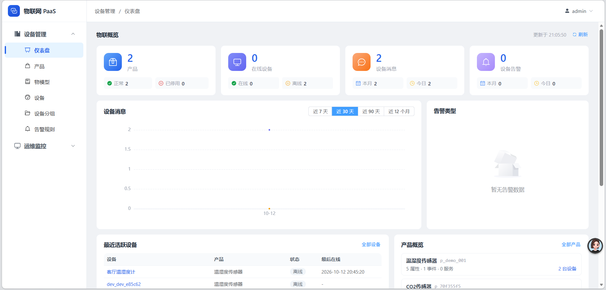
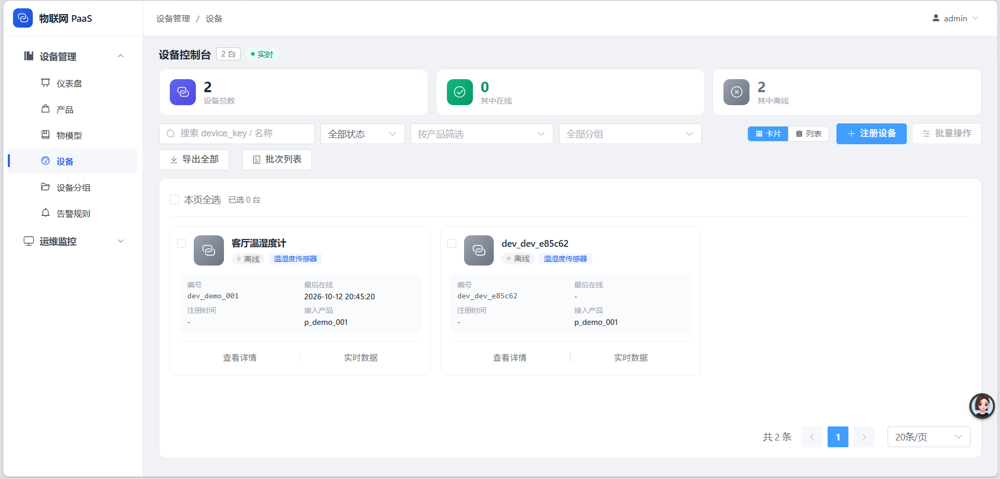
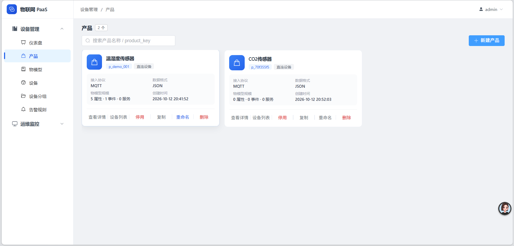
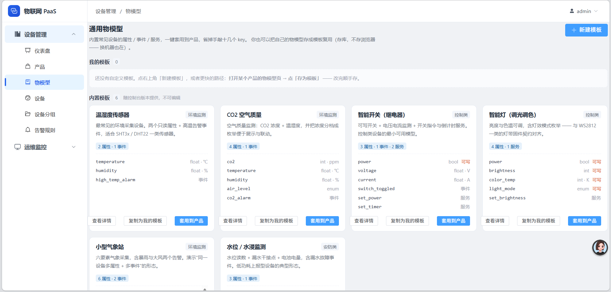
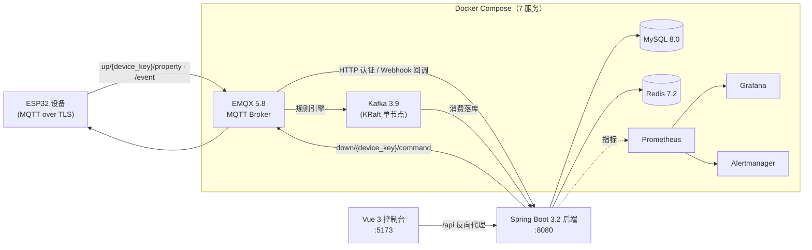

# 物联网 PaaS 云平台 · MVP

一个从**设备到云端到控制台**的完整闭环实现：ESP32 设备经 MQTT 接入，平台侧完成设备鉴权、物模型管理、指令下发、遥测落库与在线状态维护，控制台按物模型**动态渲染**每台设备的界面。

> 这不是一个"跑个 MQTT Demo"的练手项目 —— 它把物联网平台真正难的那几件事都做了：设备身份与密钥、物模型驱动的动态 UI、指令状态机与超时、遥测高吞吐写入、以及全链路可观测性。

<p align="center">
  
  
</p>

<p align="center">
  
  
</p>

<p align="center"><sub>控制台实际界面：仪表盘 · 设备控制台 · 产品管理 · 物模型模板库</sub></p>

---

## 架构



**数据流**：设备上报 → EMQX 用 HTTP 回调后端做**凭据鉴权** → 规则引擎把消息投到 Kafka → 后端消费、解析物模型、批量写入 `device_telemetry`（按 `ts` 月度分区）→ 控制台经 `/api` 读取渲染。
**指令流**：控制台下发 → 后端落库并 **REST API 让 EMQX 发布** → 设备执行后回报 ack → 后端按状态机 `0→1→2/3/4` 推进，超时由定时扫描标记。

---

## 技术栈

| 层 | 选型 |
|---|---|
| 设备端 | ESP32 + ESP-IDF（C），MQTT over TLS（mTLS 证书见 `certs/`） |
| 接入 | EMQX 5.8（HTTP 认证器 + 规则引擎 + 重发布） |
| 消息总线 | Kafka 3.9（KRaft 模式，无 ZooKeeper） |
| 后端 | Spring Boot 3.2.5 / Java 17 / MyBatis-Plus / JWT / HikariCP |
| 存储 | MySQL 8.0（12 张表，遥测表月度分区）+ Redis 7.2（凭据缓存、在线状态窗口协调） |
| 控制台 | Vue 3 + Vite 6 + Element Plus |
| 可观测 | Prometheus + Grafana（18 面板大盘）+ Alertmanager（告警路由到飞书） |

---

## 快速开始

```bash
# 1. 拉起全部基础设施（MySQL / EMQX / Redis / Kafka / 监控三件套）
docker compose up -d
```

MySQL **首次启动会自动完成**：建库建表 → 创建 `iot` 专用账号 → 灌入演示数据 → 创建管理员账号。无需手工执行任何 SQL。

```bash
# 2. 启动后端
cd iot-platform && mvn spring-boot:run     # 需 JDK 17+；或在 IDEA 中直接运行，端口 8080

# 3. 启动控制台
cd iot-console && npm install && npm run dev  # 端口 5173
```

打开 http://localhost:5173 ，用下面这组账号登录：

| 用途 | 地址 | 账号 / 口令 |
|---|---|---|
| 控制台 | http://localhost:5173 | `admin` / `admin123` |
| EMQX Dashboard | http://localhost:18083 | `admin` / `public` |
| Grafana 大盘 | http://localhost:3000 | `admin` / `admin` |
| 后端接口 | http://localhost:8080 | JWT（登录接口下发） |

演示设备：`dev_demo_001` / `demo_secret_123`。

> ⚠️ 以上口令全是**本机开发默认值**，硬编码在 `docker-compose.yml` 与初始化脚本里，生产必须全部替换。

---

## 服务与端口

| 端口 | 服务 | 说明 |
|---|---|---|
| 3306 | MySQL 8.0 | 业务库 `iot_platform`（容器内，非宿主机） |
| 1883 / 8883 | EMQX | MQTT 明文 / TLS |
| 18083 | EMQX Dashboard | 管理与排障 |
| 6379 | Redis | 凭据缓存 |
| 9092 | Kafka | 单节点 KRaft，双 listener（`kafka:29092` 容器内 / `localhost:9092` 宿主机） |
| 8080 | Spring Boot | 业务 API |
| 5173 | Vite 控制台 | 开发服务器，`/api` 反代到 8080 |
| 9090 / 3000 / 9093 | Prometheus / Grafana / Alertmanager | 可观测三件套 |

---

## MQTT 主题约定

| 方向 | Topic 模板 | payload 示例 |
|---|---|---|
| 属性上报 | `up/{device_key}/property` | `{"temperature":26.5,"humidity":60}` |
| 事件上报 | `up/{device_key}/event` | `{"key":"high_temp_alarm",...}` |
| 指令下发 | `down/{device_key}/command` | `{"request_id":"...","command_type":1,"payload":{"switch":true}}` |
| 指令回报 | `up/{device_key}/ack` | `{"request_id":"...","code":0}` |

设备身份：`client_id` = `device_key`，`username` = `device_key`，`password` = `device_secret`（后端经 HTTP 回调校验）。

---

## 数据库

`iot_platform` 共 **12 张表**，定义唯一事实源是 [`db/schema.sql`](db/schema.sql)：

`product`（物模型 + TSL）· `device` · `device_telemetry`（**遥测，按 `ts` 月度分区，13 个分区**）· `device_log`（上下线日志）· `command`（指令状态机）· `project` · `user` · 以及告警规则、设备分组等。

初始化脚本按文件名顺序各执行**一次**（仅数据卷为空时）：

| 顺序 | 文件 | 作用 |
|---|---|---|
| 01 | [`db/schema.sql`](db/schema.sql) | 建库、建表、分区与索引 |
| 02 | [`db/init-user.sql`](db/init-user.sql) | 创建 `iot` 专用账号并授权（最小权限） |
| 03 | [`db/seed.sql`](db/seed.sql) | 演示项目 / 产品 / 设备 |
| 04 | [`db/init-admin.sql`](db/init-admin.sql) | 管理员账号（BCrypt 哈希，否则全新库无法登录控制台） |

重置到干净基线（**会清空数据**）：

```bash
docker compose down -v && docker compose up -d
```

---

## 目录结构

```
.
├── docker-compose.yml        # 7 服务编排：一键拉起整套环境
├── iot-platform/             # 后端：Spring Boot 3.2 + Java 17（含完整提交历史）
├── iot-console/              # 控制台：Vue 3 + Vite 6 + Element Plus（含完整提交历史）
├── db/                       # 数据库契约 + 容器初始化脚本（唯一 DDL 事实源）
├── monitoring/               # Prometheus 抓取与告警规则、Grafana 大盘 JSON、Alertmanager 配置
├── certs/                    # TLS 证书生成脚本与说明（私钥不入库，本地生成）
├── firmware/esp32_iot/       # ESP32 设备端固件（ESP-IDF 工程）
├── docs/                     # 需求 / 设计契约 / 评审 / 压测 / 运维文档
├── 产品图/                    # 控制台界面截图（README 顶部展示用）
├── BUG_LOG.md                # 缺陷与事故的结构化记录（现象 / 根因 / 验证 / 状态）
└── Kafka消息模型示意图.html   # 单文件图解读物
```

---

## 文档导航

| 目录 | 内容 |
|---|---|
| [`docs/01_需求规划`](docs/01_需求规划) | 需求与范围 |
| [`docs/02_设计契约`](docs/02_设计契约) | 接口契约、EMQX 配置方案 —— **先签合同再写代码**，所有接口/回调报文以此为准 |
| [`docs/03_原型设计`](docs/03_原型设计) / [`docs/03_评审报告`](docs/03_评审报告) | 原型与阶段性评审 |
| [`docs/04_毕业论文`](docs/04_毕业论文) | 配套毕业设计论文 |
| [`docs/05_压测报告`](docs/05_压测报告) | 高并发写入压测数据与结论 |
| [`docs/06_运维监控`](docs/06_运维监控) | 端口与访问清单、监控大盘说明 |
| [`docs/07_求职材料`](docs/07_求职材料) | 项目经历的简历口径 |
| [`docs/项目结构快照.md`](docs/项目结构快照.md) | 运行时拓扑与模块地图 |
| [`docs/后端代码完全解读.md`](docs/后端代码完全解读.md) | 后端逐层解读 + 本地验证步骤 |
| [`docs/设备接入验证流程.md`](docs/设备接入验证流程.md) | 设备接入的端到端验证流程 |

---

## 仓库结构（单仓库 · 三模块）

本仓库是**单仓库三模块**：`iot-platform/`（后端）、`iot-console/`（控制台）、以及根目录的平台侧资产（基础设施编排、数据库契约、可观测配置、设备固件与全部设计文档）。

后端与前端**原先各自是独立仓库**，2026-10-12 以**子树并史**方式并入本仓库 —— 文件与提交历史（后端 47 提交、前端 68 提交）都完整保留，各自的 `.git` 已移除，因此克隆本仓库一次即可拿到全部源码：

```bash
git clone <本仓库> && cd <本仓库>
docker compose up -d                 # 地基建好
cd iot-platform && mvn spring-boot:run
cd iot-console  && npm install && npm run dev
```

合并的理由是它们本就同步演化、彼此以接口契约耦合；分仓时"改一个接口要跨两个仓库提交"的成本高于收益。子目录内各自的 `.gitignore` 继续生效（`target/`、`node_modules/`、`dist/` 不入库）。

---

## 本地开发约定

- **宿主机 MySQL 必须停用**：3306 端口归容器。此前平台依赖本机 `MySQL57` Windows 服务，现改为容器统一管理（含原因与踩坑记录见 [`BUG_LOG.md`](BUG_LOG.md) BUG-32）。
- **EMQX API Key 需用 bootstrap file 创建**：EMQX 5.8 的 Dashboard 创建 API Key 有已知缺陷，`/api/v5/*` 调用必须走 API Key（Dashboard 账号不可用）。
- **容器访问宿主机服务要用 `host.docker.internal`**：EMQX 的 HTTP 认证与 Webhook 回调指向宿主机的后端，`localhost` 在容器内会指向容器自己。
- **初始化脚本只在首次建库时执行**：改完 SQL 想生效必须 `down -v` 重建，不会自动重跑。

---

## 已验证

以下链路已在本机完整实测通过：

- `docker compose up -d` 一条命令拉起 7 个服务，MySQL 自动完成建库建表 + 演示数据 + 管理员账号
- 控制台 `admin/admin123` 登录 → JWT 下发 → 进首页，设备列表按物模型动态渲染
- 设备经 MQTT 上报属性 → EMQX 鉴权 → Kafka → 后端消费 → 落库 `device_telemetry`，时间戳为本地时区
- 后端在 MySQL 容器被销毁重建后**自动重连**，无需重启