# 物联网 PaaS 云平台 · 数据库表设计说明（7 表）

> 来源：`db/schema.sql`（v1.2，2026-08-30）
> 数据库：`iot_platform`　引擎：MySQL 5.7.8+ / InnoDB　字符集：utf8mb4
> 定位：本设计是「设备 → 平台 → 控制台」全链路的数据合同，接口入参出参、EMQX 回调报文、Webhook 解析逻辑均以此为准。

---

## 0. 总体设计

### 7 张表三类划分

| 分类 | 表 | 特点 |
|---|---|---|
| 业务实体表 | product、device、user、project | 用 `deleted` 软删（0 未删 1 已删，对齐 MyBatis-Plus @TableLogic） |
| 时序事件流表 | device_telemetry、device_log、command | 只增不改不删，靠分区/归档清理，**无 deleted 字段** |

### 核心约定（面试/论文可讲点）

1. **一机一密鉴权**：MQTT 连接时 clientId = device_key，username = device_key，password = device_secret。EMQX auth_http 回调 SpringBoot，查 Redis「auth:{device_key} → device_secret」比对。
2. **不用物理外键**：设备高频上报场景下，外键约束带来行锁竞争；用「逻辑外键 + 索引 + 应用层保证」替代，性能优先。
3. **遥测分区策略**：`device_telemetry` 按月 RANGE COLUMNS 分区（12 个月 + pmax）。滚月必须用 `REORGANIZE` 拆 pmax（不能 ADD PARTITION，pmax 已封顶会报错）。数据量超千万级 / 单设备秒级上报时，V2 迁 TDengine。
4. **软删约定**：业务实体表用 deleted 软删；事件流表只增不改不删。
5. **device_key → device_id 映射**：Webhook 报文带 device_key，SpringBoot 用 Redis 缓存映射，避免每次上报都查 device 表。
6. **command 幂等**：request_id 唯一，同一指令重复下发不会重复执行。

---

## 表关系总览（E-R 图，Mermaid 可直接渲染）

```mermaid
erDiagram
    project ||--o{ product : "project_id 逻辑外键"
    project ||--o{ device : "project_id 逻辑外键"
    product  ||--o{ device : "product_key 一对多"
    device   ||--o{ device_telemetry : "device_id"
    device   ||--o{ device_log : "device_id"
    device   ||--o{ command : "device_id"

    product {
        BIGINT id PK "主键"
        VARCHAR(32) product_key UK "产品唯一标识 p_demo_001"
        VARCHAR(64) name "产品名称"
        BIGINT project_id FK "所属项目(逻辑外键)"
        JSON tsl "物模型 {properties,services,events}"
    }
    device {
        BIGINT id PK "主键"
        VARCHAR(64) device_key UK "MQTT clientId/username"
        VARCHAR(32) product_key UK "所属产品(与device_name联合唯一)"
        VARCHAR(64) device_name UK "产品内友好名"
        VARCHAR(64) device_secret "设备密钥(MQTT password)"
        TINYINT online_status "0离线 1在线"
    }
    device_telemetry {
        BIGINT id PK "与ts联合主键"
        BIGINT device_id "设备主键(逻辑外键)"
        VARCHAR(64) property_key "物模型属性标识"
        VARCHAR(255) value "属性值(字符串化)"
        DATETIME(3) ts PK "上报时间(设备侧), 分区键"
    }
    device_log {
        BIGINT id PK "主键"
        BIGINT device_id "设备主键"
        TINYINT log_type "1上线 2下线 3操作 4指令 5告警"
        VARCHAR(1024) content "日志内容"
    }
    command {
        BIGINT id PK "主键"
        BIGINT device_id "目标设备主键"
        JSON payload "指令内容"
        TINYINT status "0待下发 1已下发 2已执行 3失败 4超时"
        VARCHAR(64) request_id UK "幂等键"
    }
    project {
        BIGINT id PK "主键"
        VARCHAR(64) name "项目名称"
        VARCHAR(255) description "项目描述"
    }
    user {
        BIGINT id PK "主键"
        VARCHAR(64) username UK "用户名"
        VARCHAR(100) password_hash "BCrypt哈希"
        TINYINT role "1管理员 2开发者 3观察者"
    }
```



---

## 1. product 产品表

**定位**：物模型（TSL）的入口。一个产品 = 一类设备 = 一份物模型。

| 字段 | 类型 | 默认 | 说明 |
|---|---|---|---|
| id | BIGINT UNSIGNED | AUTO_INCREMENT | 主键 |
| product_key | VARCHAR(32) | - | 产品唯一标识（对外，如 p_demo_001），唯一索引 |
| name | VARCHAR(64) | - | 产品名称 |
| project_id | BIGINT UNSIGNED | NULL | 所属项目（逻辑外键 → project.id），v1.2 补充，隔离边界完整 |
| node_type | TINYINT | 1 | 节点类型：1 直连　2 网关　3 子设备 |
| protocol | VARCHAR(16) | 'MQTT' | 接入协议（MVP 固定 MQTT） |
| data_format | VARCHAR(16) | 'JSON' | 数据格式（MVP 固定 JSON） |
| tsl | JSON | NULL | 物模型定义：`{properties:[],services:[],events:[]}` |
| status | TINYINT | 1 | 状态：1 启用　0 停用 |
| deleted | TINYINT | 0 | 软删：0 未删　1 已删 |
| created_at | DATETIME(3) | CURRENT_TIMESTAMP(3) | 创建时间 |
| updated_at | DATETIME(3) | CURRENT_TIMESTAMP(3) ON UPDATE | 更新时间 |

**索引**：PK(id)、UNIQUE `uk_product_key`(product_key)、KEY `idx_project`(project_id)

**设计要点**：
- 物模型 TSL 以 JSON 字段整体存储，MVP 阶段不拆表。
- product_key 是设备与产品关联的对外标识，产品表是设备表的上一级入口。

---

## 2. device 设备表

**定位**：一机一密三元组（product_key + device_name + device_secret），device_key 是设备接入唯一标识（MQTT 的 clientId / username）。

| 字段 | 类型 | 默认 | 说明 |
|---|---|---|---|
| id | BIGINT UNSIGNED | AUTO_INCREMENT | 主键 |
| device_key | VARCHAR(64) | - | 设备唯一标识（MQTT clientId/username），唯一索引 |
| product_key | VARCHAR(32) | - | 所属产品标识（逻辑外键 → product.product_key） |
| device_name | VARCHAR(64) | - | 设备名称（产品内友好名），与 product_key 联合唯一 |
| device_secret | VARCHAR(64) | - | 设备密钥（MQTT password，生产建议加密存储） |
| project_id | BIGINT UNSIGNED | NULL | 所属项目（逻辑外键 → project.id） |
| online_status | TINYINT | 0 | 在线状态：0 离线　1 在线 |
| last_online_at | DATETIME(3) | NULL | 最近上线时间 |
| last_offline_at | DATETIME(3) | NULL | 最近离线时间 |
| last_ip | VARCHAR(45) | NULL | 最近接入 IP |
| group_id | BIGINT UNSIGNED | NULL | 分组（V2 扩展，MVP 可空） |
| tags | VARCHAR(255) | NULL | 标签（JSON 数组） |
| status | TINYINT | 1 | 状态：1 启用　0 禁用 |
| deleted | TINYINT | 0 | 软删：0 未删　1 已删 |
| created_at | DATETIME(3) | CURRENT_TIMESTAMP(3) | 创建时间 |
| updated_at | DATETIME(3) | CURRENT_TIMESTAMP(3) ON UPDATE | 更新时间 |

**索引**：PK(id)、UNIQUE `uk_device_key`(device_key)、UNIQUE `uk_product_name`(product_key, device_name)、KEY `idx_project`(project_id)、KEY `idx_online`(online_status)

**设计要点**：
- device_key 即 MQTT clientId / username，是设备接入唯一凭证（一机一密）。
- `uk_product_name` 保证同一产品下设备名唯一。
- 在线状态冗余在设备表上（`idx_online` 支撑在线列表查询），上下线时间由回调更新。

---

## 3. device_telemetry 设备遥测表（时序数据 · 按月分区）

**定位**：物模型属性上报的落点。MVP 用 MySQL，V2 迁 TDengine（超级表/子表）。

| 字段 | 类型 | 默认 | 说明 |
|---|---|---|---|
| id | BIGINT UNSIGNED | AUTO_INCREMENT | 主键（与 ts 联合主键） |
| device_id | BIGINT UNSIGNED | - | 设备主键（逻辑外键 → device.id） |
| property_key | VARCHAR(64) | - | 物模型属性标识（如 temperature） |
| value | VARCHAR(255) | - | 属性值（字符串化存储） |
| value_type | TINYINT | 1 | 值类型：1 数值　2 字符串　3 布尔（v1.2 默认 2→1，主场景为数值型温度） |
| ts | DATETIME(3) | - | 上报时间（设备侧时间），**分区键** |

**主键**：(id, ts)——分区键 ts 必须在主键中，故联合主键。

**索引**：KEY `idx_device_ts`(device_id, ts)、UNIQUE `uk_device_prop_val_ts`(device_id, property_key, value, ts)、KEY `idx_device_prop_ts`(device_id, property_key, ts)

> 唯一键 `uk_device_prop_val_ts` 承担 **D2 幂等去重**（BUG-19/BUG-20）：
> - **键须含 value**（BUG-20 教训）：若仅 `(device_id,property_key,ts)`，QoS0 突发多报文共享同一毫秒 EMQX 时间戳 `ts`，不同上报会被唯一键误判为"同一上报"折叠、`ON DUPLICATE` 静默丢 ~90% 数据；`value` 入键后并发上报 value 不同 → 不误删，真重放 value+ts 全同 → 仍正确去重。
> - `ts` 是分区键，唯一键含 `ts` 以满足"唯一键须含分区列"的约束。
> - ⚠️ 一物两索引分工（已落地）：唯一键 `uk_device_prop_val_ts` 中 `value` 列在中间，无法直接支撑 `(device_id,property_key)+ts 范围` 的索引级裁剪；故补普通索引 `idx_device_prop_ts(device_id,property_key,ts)` **专供查询**（按属性查区间/取最新走它），与幂等唯一键解耦，各自职责单一。

**分区**：`PARTITION BY RANGE COLUMNS (ts)`，预建 2026-08 至 2027-07 共 12 个月分区 + pmax（MAXVALUE）。

**滚月操作（重要）**：必须用 REORGANIZE 拆分 pmax，不能 ADD PARTITION：

```sql
ALTER TABLE device_telemetry REORGANIZE PARTITION pmax INTO (
  PARTITION p202708 VALUES LESS THAN ('2027-09-01'),
  PARTITION pmax    VALUES LESS THAN (MAXVALUE));
```

建议用 MySQL EVENT 或后端定时任务每月 1 号自动执行。

**设计要点**：
- 事件流表：只增不改不删，靠分区/归档清理，无 deleted 字段。
- value 统一字符串化存储，配合 value_type 解释类型，换取存储简单。

---

## 4. device_log 设备日志表

**定位**：上下线、操作、指令、告警等事件，用于问题追溯。

| 字段 | 类型 | 默认 | 说明 |
|---|---|---|---|
| id | BIGINT UNSIGNED | AUTO_INCREMENT | 主键 |
| device_id | BIGINT UNSIGNED | - | 设备主键（逻辑外键 → device.id） |
| log_type | TINYINT | - | 类型：1 上线　2 下线　3 操作　4 指令　5 告警 |
| content | VARCHAR(1024) | NULL | 日志内容 |
| created_at | DATETIME(3) | CURRENT_TIMESTAMP(3) | 记录时间 |

**索引**：PK(id)、KEY `idx_device_time`(device_id, created_at)

**设计要点**：
- 事件流表：只增不改不删，无 deleted 字段。
- 按设备 + 时间索引，支撑「设备维度时间线」追溯查询。

---

## 5. command 指令表（控制下发状态追踪）

**定位**：下发链路状态机——控制台/API → 本表落一条 → EMQX REST API → 设备 → 回报更新状态。

| 字段 | 类型 | 默认 | 说明 |
|---|---|---|---|
| id | BIGINT UNSIGNED | AUTO_INCREMENT | 主键 |
| device_id | BIGINT UNSIGNED | - | 目标设备主键（逻辑外键 → device.id） |
| command_type | TINYINT | - | 类型：1 属性下发　2 服务调用 |
| payload | JSON | - | 指令内容（如 `{"switch":true}`，扁平属性映射，与遥测上报同构） |
| status | TINYINT | 0 | 状态：0 待下发　1 已下发　2 已执行　3 失败　4 超时 |
| request_id | VARCHAR(64) | - | 幂等键（每次下发唯一，防重复），唯一索引 |
| sent_at | DATETIME(3) | NULL | 下发时间 |
| ack_at | DATETIME(3) | NULL | 设备回报时间 |
| created_at | DATETIME(3) | CURRENT_TIMESTAMP(3) | 创建时间 |
| updated_at | DATETIME(3) | CURRENT_TIMESTAMP(3) ON UPDATE | 状态机变更时间（v1.2 补充） |

**索引**：PK(id)、UNIQUE `uk_request_id`(request_id)、KEY `idx_device_status_time`(device_id, status, created_at)、KEY `idx_status_sent`(status, sent_at)（v1.2 补充，支撑超时扫描）

**设计要点**：
- request_id 幂等：同一指令重复下发不会产生重复执行。
- 状态机变更走 updated_at 审计，事件流表无 deleted。
- `idx_status_sent` 专门支撑「扫描超时未确认指令」的后台任务。

---

## 6. project 项目表

**定位**：单租户多项目，资源隔离边界。product / device 的 project_id 逻辑外键均指向此处。

| 字段 | 类型 | 默认 | 说明 |
|---|---|---|---|
| id | BIGINT UNSIGNED | AUTO_INCREMENT | 主键 |
| name | VARCHAR(64) | - | 项目名称 |
| description | VARCHAR(255) | NULL | 项目描述 |
| deleted | TINYINT | 0 | 软删：0 未删　1 已删 |
| created_at | DATETIME(3) | CURRENT_TIMESTAMP(3) | 创建时间 |
| updated_at | DATETIME(3) | CURRENT_TIMESTAMP(3) ON UPDATE | 更新时间 |

**索引**：PK(id)

**设计要点**：
- 业务实体表，deleted 软删。
- MVP 阶段即建表，避免后期 ALTER（账号权限模块 D8 前端前启用）。

---

## 7. user 用户表

**定位**：JWT 登录，三级 RBAC 权限模型。

| 字段 | 类型 | 默认 | 说明 |
|---|---|---|---|
| id | BIGINT UNSIGNED | AUTO_INCREMENT | 主键 |
| username | VARCHAR(64) | - | 用户名，唯一索引 |
| password_hash | VARCHAR(100) | - | BCrypt 哈希（禁止明文） |
| role | TINYINT | 2 | 角色：1 管理员　2 开发者　3 观察者 |
| status | TINYINT | 1 | 状态：1 启用　0 禁用 |
| deleted | TINYINT | 0 | 软删：0 未删　1 已删 |
| created_at | DATETIME(3) | CURRENT_TIMESTAMP(3) | 创建时间 |
| updated_at | DATETIME(3) | CURRENT_TIMESTAMP(3) ON UPDATE | 更新时间 |

**索引**：PK(id)、UNIQUE `uk_username`(username)

**设计要点**：
- 密码只存 BCrypt 哈希，禁止明文。
- 三级 RBAC：管理员 / 开发者 / 观察者，配合 JWT 登录。

---

## 附：表间关系一句话总结

```
project (1) ──< product (1) ──< device (1) ──< device_telemetry
                    │              │
                    │              ├──< device_log
                    │              └──< command
                    └── project (1) ──< device（project_id 同时挂在 device 上）
```

- product、device 通过 project_id 归属 project（资源隔离）。
- device 通过 product_key 归属 product。
- device_telemetry / device_log / command 通过 device_id 归属 device（事件流）。
