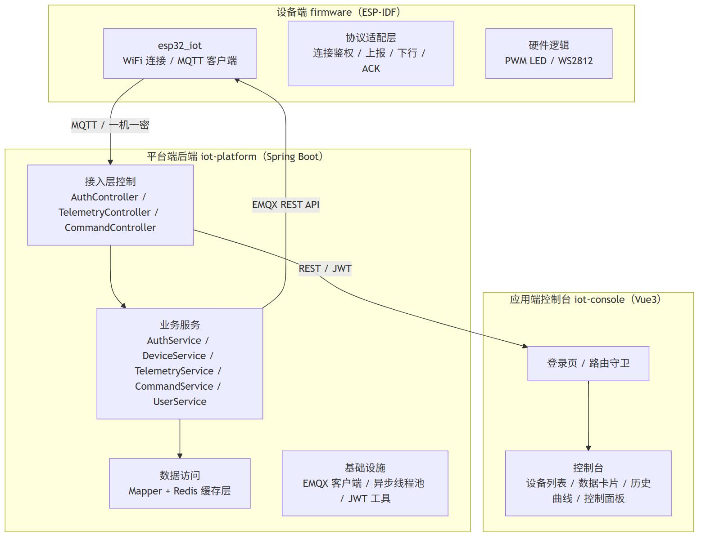
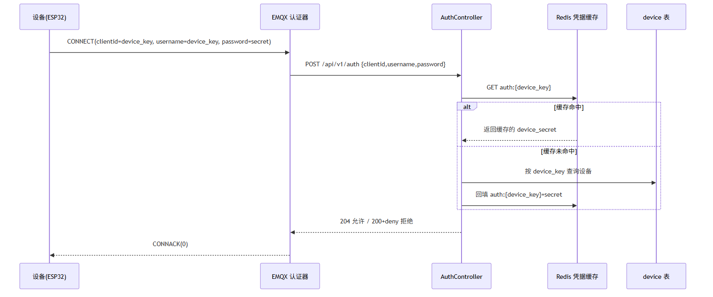
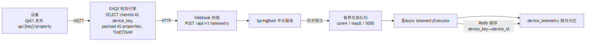
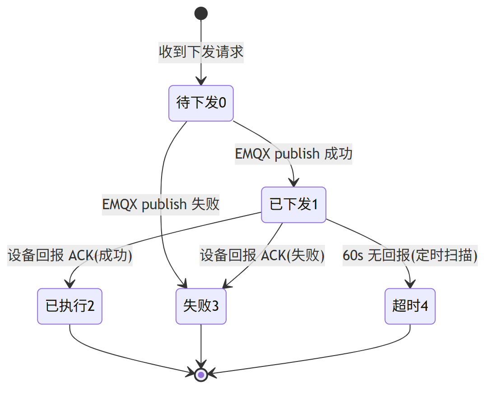
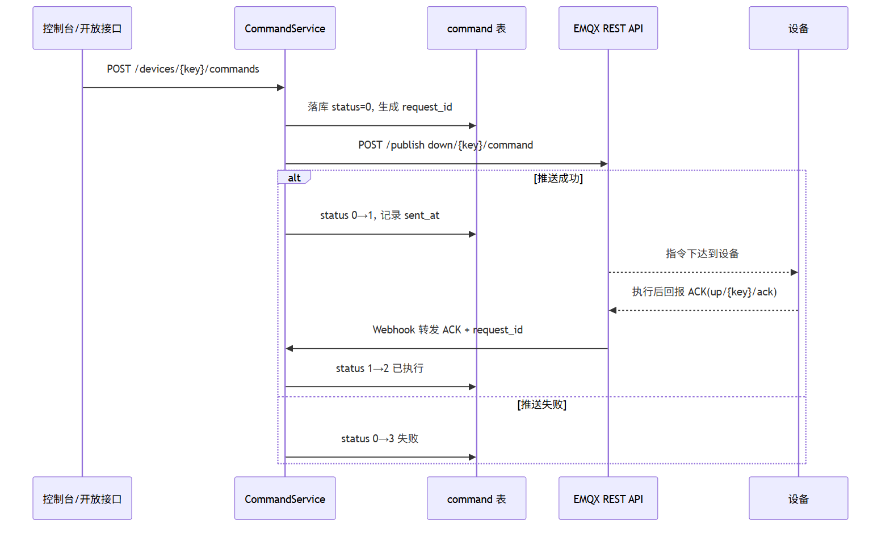
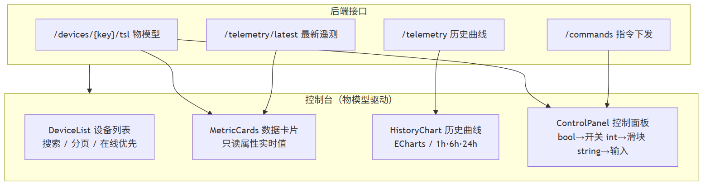

# 物联网 PaaS 云平台的设计与实现

> 论文初稿 · 第 3 章正文
> 依据《毕业论文初稿_第1-2章大纲》撰写，素材取自数据库表结构 schema.sql、后端工程 iot-platform、前端工程 iot-console 及项目实际实现
> 版本：v0.1（初稿）  日期：2026-09-05

---

# 第 3 章　系统详细设计与实现

在第 2 章总体设计的基础上，本章详细阐述系统的实现方案。本章按照"数据模型 → 设备接入 → 数据上报 → 设备管理 → 控制下发 → 前端控制台"的实现顺序，逐模块介绍设计思路与关键实现，并重点剖析物模型 TSL 贯穿全链路、鉴权抗风暴、遥测高吞吐入库、指令状态机等关键技术难点的实现方案。

## 3.1 系统实现总体框架

系统采用模块化单体的工程组织方式，将功能边界清晰、耦合度低的模块以包和目录维度划分，既保证了单体应用的可维护性，又通过接口抽象为未来水平扩展预留空间。整个工程由三部分组成，如图 3-1 所示。



**图 3-1　系统实现总体框架**

设备端基于 ESP-IDF 框架构建，硬件采用 ESP32-S3，运行环境分为 WiFi 连接、MQTT 客户端、协议适配层与硬件逻辑四部分，其中协议适配层将 MQTT 连接鉴权、属性上报、指令下行接收与回报 ACK 封装为对上层透明的接口，硬件逻辑（PWM LED 调光、WS2812 全彩灯串）完全复用原有实现，不感知平台协议细节，体现了设备端接入层的可剥离性。

后端工程 `iot-platform` 采用标准的四层分包结构：`controller` 层暴露 REST 接口并承担参数校验，`service` 及 `service.impl` 层承载业务逻辑，`mapper` 层基于 MyBatis-Plus 进行数据访问，`entity` 层定义与数据库表对应的实体。此外，`dto` 层定义接口出入参，`config` 层负责异步线程池、Redis、JWT 等基础设施配置，`client` 层封装对 EMQX REST API 的调用，`common` 层统一返回结构与异常处理。

控制台前端 `iot-console` 基于 Vue 3 + Element Plus 构建，采用 Vite 作为构建工具，通过"物模型驱动"的方式从后端获取产品 TSL 定义并动态渲染设备数据与控件，业务代码不写死具体属性，实现了同界面适配任意产品的通用化能力。

## 3.2 数据模型设计

数据模型是全链路的"数据契约"，直接决定接口入参出参、EMQX 回调报文与物模型解析逻辑的形态。系统数据库 `iot_platform` 共设计七张表，按数据性质划分为业务实体表与事件流表两类，如表 3-1 所示。

**表 3-1　数据库表设计一览**

| 表名 | 类别 | 承载数据 | 关键设计 |
|------|------|---------|---------|
| `product` | 业务实体 | 产品定义与物模型 TSL | `tsl` JSON 字段，`product_key` 唯一 |
| `device` | 业务实体 | 设备元数据与接入凭据 | `device_key` 唯一，一机一密三元组 |
| `project` | 业务实体 | 项目（资源隔离边界） | 单租户多项目 |
| `user` | 业务实体 | 控制台用户 | BCrypt 密码哈希 |
| `device_telemetry` | 事件流 | 物模型属性时序数据 | 按月 RANGE COLUMNS 分区 |
| `device_log` | 事件流 | 上下线/操作/指令日志 | 只增不改不删 |
| `command` | 事件流 | 控制下发状态追踪 | `request_id` 幂等，状态机字段 |

**设备接入的三元组约定**是整条链路的鉴权基础：每台设备分配 `device_key`（MQTT 连接的 clientId 与 username）、`device_secret`（MQTT 连接的 password）以及所属产品的 `product_key`。设备接入时，EMQX 将连接三元组回调至平台鉴权接口校验，平台通过 Redis 缓存凭据以抵御批量设备上电引发的连接风暴。

**数据模型设计上采用了两项关键权衡**。其一，采用逻辑外键而非物理外键：设备高频上报场景下，外键约束会带来行锁竞争，故以"逻辑外键 + 索引 + 应用层保证"替代，兼顾数据完整性约束与写入性能。其二，事件流表（`device_telemetry`、`device_log`、`command`）遵循只增不改不删原则，不设软删字段，依靠分区与归档清理，以保证时序数据的高效顺序写入与历史可回溯性；业务实体表（`product`、`device`、`project`、`user`）则通过 `deleted` 字段实现软删除，与 MyBatis-Plus 的逻辑删除注解对齐。

**时序数据的分区策略**是数据模型设计的核心。`device_telemetry` 表按月采用 RANGE COLUMNS 分区，共划分 13 个分区（12 个月份分区加一个 `pmax` 兜底分区）。由于分区键 `ts` 必须包含于主键中，该表的主键设计为复合主键 `(id, ts)`。当月数据变更时，新分区通过 `REORGANIZE` 拆分 `pmax` 分区创建，避免了 `ADD PARTITION` 在分区边界严格递增约束下无法直接插入新分区的限制。按月分区将冷热数据物理隔离，既便于按月归档过期数据，也通过分区裁剪显著缩小了按时间范围查询的扫描范围，配合 `idx_device_prop_ts`（设备、属性、时间）复合索引，支撑高频时序查询。

## 3.3 设备注册与物模型管理

设备接入平台前须完成注册，平台为每台设备签发唯一的接入凭据。`DeviceService` 提供单个注册与批量注册两个接口，批量注册单次上限为 1000 台，用于测试环境批量造数或生产环境的批量迁移。

设备注册的核心逻辑如下：单个注册时，平台校验设备所属产品存在后，若调用方未显式指定 `device_key`，则按 `dev_{前缀}_{时间戳}_{序号}` 规则自动生成，并通过 `SecureRandom` 生成 16 字节随机数转十六进制作为 `device_secret`；随后对 `device_key` 全局唯一性与 `product_key + device_name` 组合唯一性进行双重校验，保证同产品下设备名称不冲突，最终写入 `device` 表并返回凭据。注册接口仅返回一次明文 `device_secret`，平台侧将其明文存储，作为 MQTT 连接密码在鉴权时直接比对——一机一密场景下 secret 即设备密码，需通过数据库访问权限隔离加以保护。

物模型（TSL）作为全链路的数据契约，存储于 `product` 表的 `tsl` JSON 字段。其结构以属性（properties）、服务（services）、事件（events）三类功能定义组织。以演示产品的温湿度传感器物模型为例，其定义如下：

```json
{
  "properties": [
    { "key": "temperature", "name": "温度", "type": "float", "access": "readonly", "unit": "℃" },
    { "key": "humidity",    "name": "湿度", "type": "float", "access": "readonly", "unit": "%" },
    { "key": "switch",      "name": "开关", "type": "bool",  "access": "readwrite" }
  ],
  "services": [],
  "events": [ { "key": "high_temp_alarm", "name": "高温告警" } ]
}
```

平台向控制台暴露 `GET /api/v1/devices/{key}/tsl` 接口，按设备定位其所属产品并返回物模型。该接口与设备上报解析共用同一份 TSL 定义，保证了"上报解析"与"应用渲染"两端对属性标识、数据类型、读写权限理解的一致性，从根源上避免了"设备侧用一个字段名、应用侧按另一个字段名解析"的数据孤岛问题。

## 3.4 设备接入与鉴权模块

设备接入采用 MQTT 一机一密认证机制，由 EMQX 的 HTTP 认证器与平台鉴权接口协同完成。设备连接时，EMQX 收到 CONNECT 报文后，向平台 `POST /api/v1/auth` 发起认证回调，由平台校验凭据后返回允许或拒绝结果。认证流程如图 3-2 所示。



**图 3-2　设备鉴权时序图**

鉴权接口的实现遵循 Cache-Aside 模式：首次请求先查询 Redis 中 `auth:{device_key}` 键，若命中则直接比对缓存中的 `device_secret` 与请求密码；若未命中再回查 `device` 表，并将结果回填 Redis 供后续使用。该缓存机制具有双重作用：一是将数据库访问降低为首次连接的一次开销，显著提升鉴权吞吐；二是当出现缺陷设备或批量上电引发的连接风暴时，大量重复连接请求直接命中缓存，不冲击数据库，构成连接风暴防护的第一道防线。

设备端在 MQTT 建连时携带三元组凭据：clientId 与 username 均为 `device_key`，password 为 `device_secret`。EMQX 认证器通过 Body 模板将 `clientid`、`username`、`password` 三个字段封装为 JSON 回调平台，平台校验通过返回 204，EMQX 据此允许连接。整个认证链路将"凭据校验"从消息中间件中剥离，交由业务平台统一管理，使设备凭据的签发、吊销、轮换等策略可在业务层集中演进，而不必修改中间件配置。

## 3.5 数据上报与存储模块

数据上报模块实现"设备属性上报 → 规则引擎转发 → 异步入库"的完整链路，是该平台吞吐能力的关键所在。设备周期性将属性报文发布到 `up/{device_key}/property` 主题，EMQX 规则引擎通过 SQL 语句从报文中提取 `device_key`、payload 与时间戳，经 Webhook 桥接 HTTP 推送至平台 `POST /api/v1/telemetry` 接口。上报链路如图 3-3 所示。



**图 3-3　数据上报与存储链路**

规则引擎 SQL `SELECT clientid AS device_key, payload AS properties, timestamp AS ts FROM "up/+/property"` 仅匹配属性上报主题，通过主题通配符将 `up/{device_key}/event` 等事件报文排除在外，避免事件数据污染遥测表。Webhook 桥接将报文封装为 `{device_key, ts, properties}` 结构推送至平台。

平台接收上报后，采用 **异步化 + 有界队列** 的处理策略应对高吞吐：`TelemetryService.process` 方法标注 `@Async("telemetryExecutor")`，由独立线程池异步执行，Web 线程只负责接收请求并快速提交任务。线程池核心线程 4、最大线程 8、队列容量 5000，参数经压测调优确定，通过有界队列在瞬时流量峰值时削峰，避免无界缓存导致的内存溢出与 `RejectedExecutionException` 任务拒绝，实现"宁可排队、不可丢失"的可靠性目标。

异步处理内部按三步执行：**其一，设备映射**，通过 Redis 缓存 `did:{device_key}` 完成 device_key 到 device_id 的映射，映射未命中时回查数据库并回填缓存，避免了每次上报都查询 `device` 表的高频 IO；**其二，属性入库**，遍历上报的属性对象，按物模型将每项属性解析为 `{device_id, property_key, value, value_type, ts}` 记录逐条写入 `device_telemetry` 表，其中 `value_type` 依据值的运行时类型推断（number→数值、boolean→布尔、其余→字符串），时间轴统一采用平台侧（EMQX 接收）时间戳；**其三，在线状态刷新**，通过条件更新语句（`online_status=0` 时置 1）判定设备是否发生离线到在线的状态跃迁，仅跃迁时写入上线日志，已在线的设备仅刷新最近在线时间，避免日志冗余写入。

该模块采用设备侧重 QoS 1 消息（至少一次投递）配合平台端有界队列与幂等写入，在保证不丢消息的前提下，通过异步化将磁盘 IO 与上报接收解耦，使平台能够在有限资源下稳定承接上千条/秒的上报速率。

## 3.6 设备管理与在线状态模块

设备管理模块涵盖设备列表查询、上下线状态维护与日志记录三方面能力，在线状态的准确性直接决定控制台展示的可信度。

**列表查询**采用"在线优先 + 关键字模糊 + 分页"的组合策略。查询时以 `online_status DESC, last_online_at DESC` 排序，将在线设备置顶并按最近上线时间排序，离线设备按最近活动时间排序，使运维人员第一时间定位活跃设备；同时支持按 `device_key` 或设备名称模糊搜索，配合每页 20 条的 MyBatis-Plus 分页，解决了设备规模增长后最早注册设备无法浏览的问题。`online_status` 已建索引，设备量级增长后可进一步补充 `(online_status, last_online_at)` 复合索引以优化排序查询。

**在线状态维护**采用"上报即在线、超时判离线"的心跳机制。设备每次上报均刷新 `last_online_at`，作为其存活心跳。系统通过定时任务 `offlineScan` 每 30 秒扫描一次 `online_status=1` 且最近在线时间超过 60 秒阈值的设备，将其置为离线并写入下线日志。该机制采用"时间戳心跳 + 后台扫描"而非 MQTT 遗嘱消息，具有两点优势：一是判定标准统一，无论设备正常断开还是异常失联均以最近上报时间为准，逻辑简单可靠；二是将状态刷新与业务上报解耦，设备无需维护额外的保活开销。

上下线事件均写入 `device_log` 表（上线 type=1、下线 type=2），构成完整的状态流记录，供问题追溯与在线率统计使用。在线状态同时作为设备列表排序权重与展示标志，实现了"存储即展示"的一致性。

## 3.7 设备控制与指令下发模块

设备控制模块实现"控制台/接口 → 指令落库 → EMQX 下发 → 设备执行 → 回报 ACK"的闭环，其核心是指令状态机的完整设计。指令状态机覆盖五种状态：0 待下发、1 已下发、2 已执行、3 失败、4 超时，状态流转规则如图 3-4 所示。



**图 3-4　指令状态机**

指令下发的实现流程如图 3-5 所示。`CommandService.dispatch` 方法首先将指令落库（状态置为 0），生成全局唯一的 `request_id` 作为指令幂等键；随后交由 `EmqxClient` 调用 EMQX REST API 向 `down/{device_key}/command` 主题推送消息，消息体携带 `request_id`、指令类型与参数；推送成功则将状态更新为 1（已下发）并记录下发时间，失败则置为 3（失败）。



**图 3-5　指令下发与回报时序图**

指令回报的 ACK 处理实现了严格的**幂等与防重**保证。设备执行指令后向 `up/{key}/ack` 主题回报结果，经 EMQX 规则引擎 Webhook 转发至平台 `POST /api/v1/commands/ack`。平台仅允许 `status=1`（已下发）的指令被确认，并用带 `status=1` 条件约束的条件更新语句完成状态变更：同一指令的重复 ACK 因当前状态已非 1 而被忽略，杜绝了重复执行；在并发场景下，若超时扫描或另一条 ACK 已抢先变更状态，条件更新影响行数为 0，平台据此识别竞争并直接返回最新状态，保证了状态机在并发下的一致性。

**超时处理**通过后台定时扫描实现。系统每 30 秒执行 `timeoutScan`，扫描 `status=1` 且下发时间在 60 秒前仍未回报的指令，将其置为超时（4）。扫描借助 `idx_status_sent`（状态、下发时间）复合索引，以状态过滤再按时间截断的方式，避免了对指令表的全表扫描，使扫描成本与待超时指令规模相关而非与历史指令总量相关。

指令状态机通过"落库即记录、推送即更新、回报即确认、定时即兜底"的设计，配合 `request_id` 幂等键与条件更新并发控制，覆盖了下发失败的三种典型场景（中间件不可达、设备离线不回报、设备回报丢失），实现了指令全生命周期的可追踪与可审计。

## 3.8 前端控制台实现

前端控制台基于 Vue 3 + Element Plus + ECharts 构建，采用 Vite 作为构建工具，后端接口经 Vite 开发代理转发至平台服务，实现前后端分离开发。控制台由登录页与控制台页两大部分组成，核心特点是**以物模型 TSL 驱动动态渲染**，业务层不写死具体属性。

**登录与鉴权**环节，控制台通过 `POST /api/v1/login` 提交用户名密码，平台以 BCrypt 校验密码后签发 JWT 令牌。前端将令牌存入 localStorage，并在路由守卫中校验登录态：未携带有效令牌访问受保护路由时重定向至登录页；所有业务请求统一携带 `Authorization: Bearer <token>` 头，实现无状态会话。平台通过 `JwtInterceptor` 拦截器对 `/api/v1/**` 下的控制台业务接口实施令牌强制校验：拦截器解析请求头中的 Bearer 令牌，校验签名与有效期，缺失或非法令牌统一返回 HTTP 401 与业务码 4010；同时放行登录接口与 EMQX 设备侧回调接口（`/auth`、`/telemetry`、`/commands/ack`），避免设备接入链路被控制台鉴权误伤。前端响应拦截器捕获 401 后清除本地令牌并跳转登录页，形成"签发—携带—校验—失效重登"的完整鉴权闭环。密码在数据库以 BCrypt 哈希存储，即便数据泄露也不暴露明文。

**物模型驱动的动态渲染**是控制台区别于固定界面方案的核心设计。控制台页加载时，向 `/api/v1/devices/{key}/tsl` 拉取设备所属产品的物模型定义，据此动态生成界面元素：物模型的 `properties[access=readonly]`（只读属性）渲染为数据卡片，定时轮询展示实时值；`properties[access=readwrite]`（可读写属性）在渲染数据卡片的同时，按其数据类型渲染对应控件——布尔型渲染为开关、整型与浮点型渲染为滑块、字符串型渲染为输入框；`services`（服务）则渲染为可点击的服务调用按钮。该设计使同一套控制台代码无需改动即可适配不同产品，新增产品只需扩展其物模型定义，体现了 TSL 作为数据契约对"上报解析"与"应用渲染"两端的统一驱动，如图 3-6 所示。



**图 3-6　前端控制台物模型驱动结构**

**数据展示与交互**方面，控制台以 5 秒为周期轮询最新遥测接口刷新数据卡片，实现准实时的数据更新；历史曲线模块按属性切换展示各属性的时序数据，提供 1 小时、6 小时、24 小时三档时间窗口，数据经 ECharts 折线图呈现，帮助用户直观把握数据变化趋势。控制面板中的可写控件响应操作后调用指令下发接口，前端随即轮询 `GET /api/v1/commands/{request_id}` 追踪指令状态，直至其到达已执行、失败或超时的终态，实现了"下发—状态回显"的操作闭环。

控制台整体采用组件化拆分（设备列表、数据卡片、历史曲线、控制面板四个独立组件），由 `Console` 页面聚合编排，数据流单向自上而下，既保证了界面可扩展性，也与后端"物模型驱动"的设计理念保持一致，共同支撑了平台对不同产品、不同场景的通用接入能力。

## 3.9 本章小结

本章按模块详细阐述了系统的设计实现。数据模型以物模型 TSL 为统一数据契约，采用逻辑外键与按月分区设计兼顾完整性与性能；设备接入以一机一密认证配合 Redis 凭据缓存抵御连接风暴；数据上报以异步入库与有界队列削峰支撑高吞吐；在线状态以"上报即在线、超时判离线"的心跳机制保证准确；控制下发以完整的指令状态机结合幂等与超时扫描实现全生命周期可追踪；前端控制台以物模型驱动动态渲染实现通用接入。各模块既独立高聚，又通过物模型契约与既有索引相互衔接，共同构成了可接入真实设备的完整物联网平台。