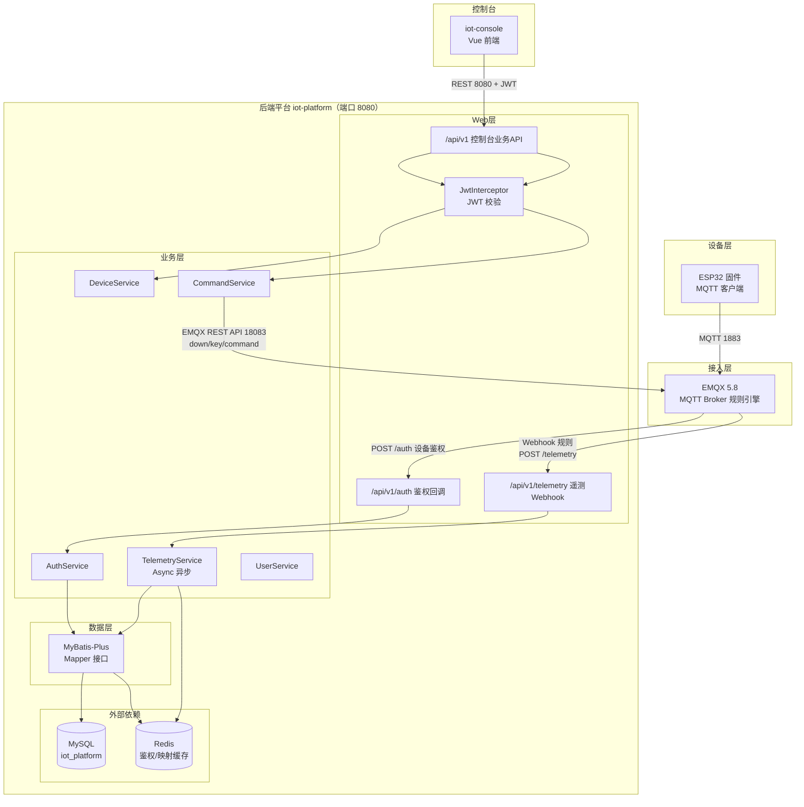
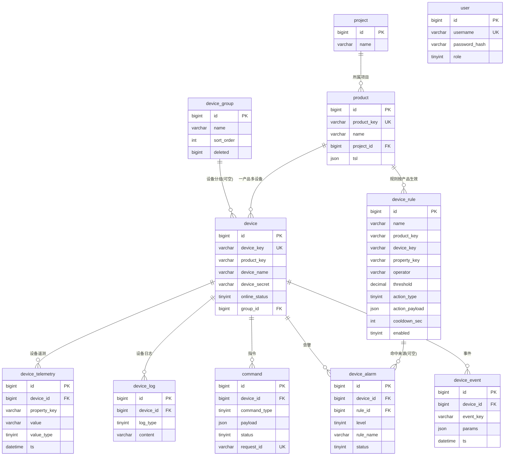
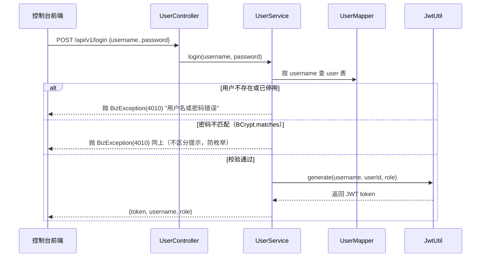
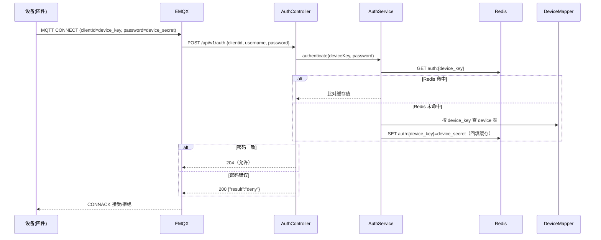
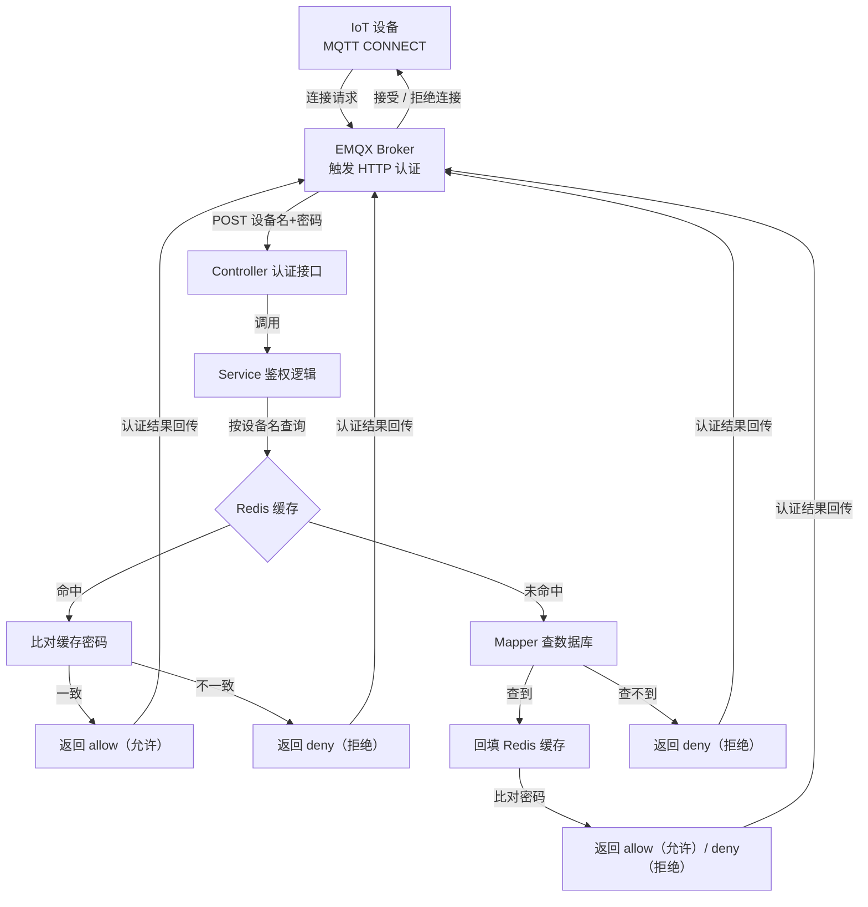
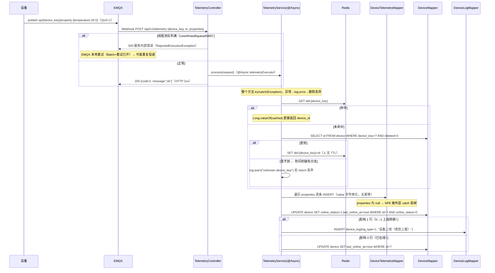
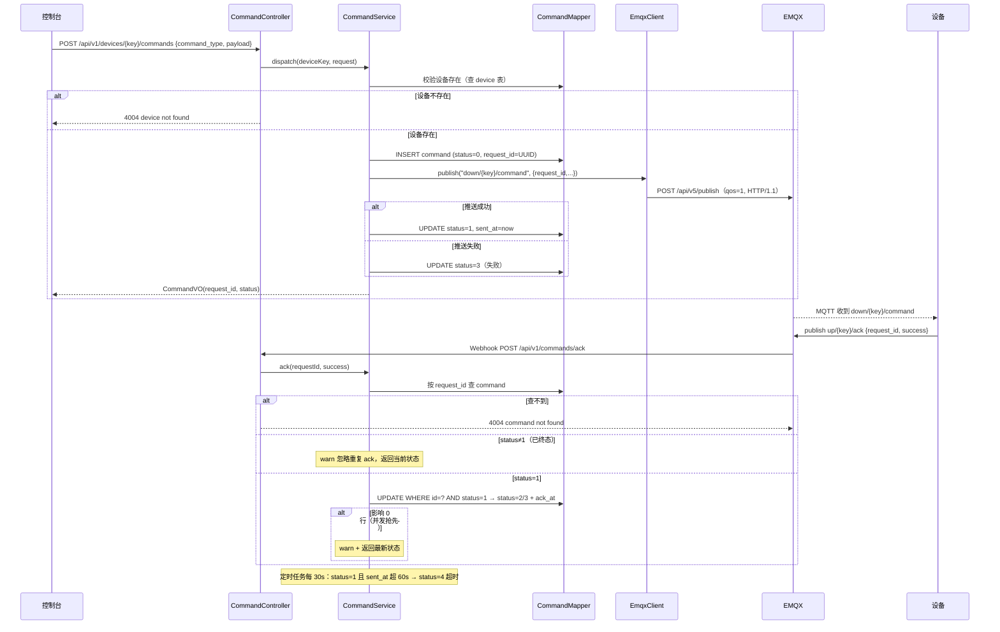
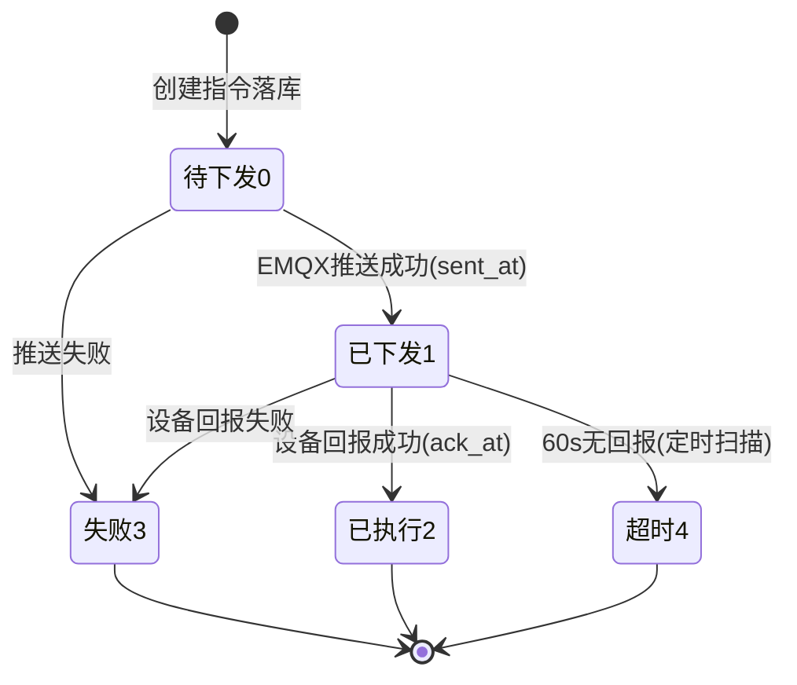
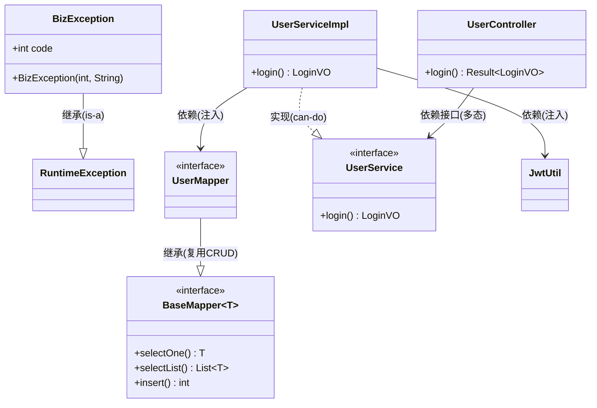

# 物联网 PaaS 云平台・后端代码完全解读

> 版本：v1.1　日期：2026-09-06
> 对象：
>
> `iot-platform`
>
> （Spring Boot 3.2.5 / Java 17）
> 目的：把 AI 生成的代码逐层讲透，作为 Java/Spring 复习与论文素材
> v1.1 变更：新增「七、Java 面向对象基础：类・接口・实现」，用本项目真实代码补讲 OOP 基础（原七 / 八 / 九 顺延为八 / 九 / 十）


***

## 目录


1. [项目定位与技术栈](#一项目定位与技术栈)

2. [代码目录地图](#二代码目录地图)

3. [核心数据模型（11 张表）](#三核心数据模型11-张表)

4. [四大核心链路（一次看懂全流程）](#四四大核心链路)

5. [分层代码逐个讲](#五分层的代码逐个讲)

6. [关键设计点（面试 / 论文可讲）](#六关键设计点)

7. [Java 面向对象基础：类・接口・实现](#七java-面向对象基础类接口实现)

8. [Java / Spring 知识点复习索引](#八java--spring-知识点复习索引)

9. [本地运行与端到端联调](#九本地运行与端到端联调)

10. [已发现的坑与改进建议](#十已发现的坑与改进建议)


***

## 一、项目定位与技术栈

这是一个**物联网 PaaS 云平台 MVP**，核心能力三件事：


| 能力   | 说明                            |
| ---- | ----------------------------- |
| 设备接入 | 设备通过 MQTT 连 EMQX，平台校验凭据（一机一密） |
| 遥测存储 | 设备上报的温度 / 湿度等属性值，平台落库并供查询     |
| 指令下发 | 控制台给设备发指令（如开 / 关开关），跟踪执行结果    |

### 技术栈一览


| 组件                | 版本    | 在本项目里的角色                     |
| ----------------- | ----- | ---------------------------- |
| Spring Boot       | 3.2.5 | Web 框架（REST 接口、IoC 容器、定时任务）  |
| Java              | 17    | 语言（LTS 版本）                   |
| MyBatis-Plus      | 3.5.5 | ORM：实体类 ↔ 数据库表，内置 CRUD       |
| MySQL             | 5.7/8 | 主数据库（业务表 + 遥测时序表）            |
| Redis             | 7.2   | 缓存：设备鉴权凭据、device\_key→id 映射  |
| EMQX              | 5.8   | MQTT Broker：设备接入网关、消息路由      |
| JWT (jjwt 0.12.5) | —     | 控制台登录令牌                      |
| BCrypt            | —     | 密码哈希（spring-security-crypto） |
| Lombok            | —     | 消除样板代码（getter/setter 等）      |

### 系统整体架构（Mermaid 代码，可直接渲染）





***

## 二、代码目录地图

后端共 **54 个 Java 文件**，全部位于 `src/main/java/com/iot/platform/` 下，按包分层：


```
com.iot.platform

├── IotPlatformApplication.java     启动类

├── config/      6 个配置类        （WebMvc/Redis/Async/MyBatisPlus/JWT属性/EMQX属性）

├── interceptor/ 1 个拦截器        （JwtInterceptor JWT 鉴权）

├── common/      4 个通用类        （Result/ErrorCode/BizException/全局异常处理）

├── controller/  5 个控制器        （Auth/User/Device/Telemetry/Command）

├── service/     10 个文件         （5 接口 + 5 实现）

├── mapper/      7 个 Mapper       （数据访问接口）

├── entity/      11 个实体类       （对应 11 张表）

├── dto/         11 个 DTO         （请求/响应对象）

├── util/        1 个工具类        （JwtUtil）

└── client/      1 个客户端        （EmqxClient 调 EMQX REST API）
```

### 一句话记住每层职责（Java 三层架构复习）


| 层                 | 职责                                        | 类比             |
| ------------------ | ------------------------------------------- | ---------------- |
| Controller(控制层) | 接收 HTTP 请求、参数校验、返回结果          | 前台接待员       |
| Service(应用层)    | 业务逻辑：规则、事务、调用其他服务          | 业务办理窗口     |
| Mapper(数据访问层) | 数据库读写（SQL 或 MyBatis-Plus 自动 CRUD） | 档案室管理员     |
| Entity(实体类)     | 一张表对应一个 Java 类                      | 档案表格模板     |
| DT()               | 接口收发的数据对象（和数据库表解耦）        | 给前台的表格单据 |

**核心原则：请求先到 Controller → 校验后交给 Service → Service 操作 Mapper → Mapper 读写数据库 → 结果原路返回。**


***

## 三、核心数据模型（11 张表）

### 表关系（E-R，Mermaid 代码）




### 每张表的核心字段与设计意图


| 表                     | 核心字段                                      | 一句话理解                              | 关键设计                      |
| --------------------- | ----------------------------------------- | ---------------------------------- | ------------------------- |
| `project` 项目          | name                                      | 资源隔离的顶层边界                          | 软删（deleted）               |
| `product` 产品          | product\_key、tsl                          | 一类设备的模板，tsl 是 "物模型"JSON            | 软删；project\_id 归属项目       |
| `device` 设备           | device\_key、device\_secret、online\_status | 一台真实设备，**device\_key 是 MQTT 接入标识** | 软删；uk\_device\_key；一机一密   |
| `device_telemetry` 遥测 | device\_id、property\_key、value、ts         | 设备上报的属性值（时序数据）                     | **按月分区**；只增不改             |
| `device_log` 日志       | device\_id、log\_type、content              | 上下线 / 操作 / 告警事件                    | 只增不改                      |
| `command` 指令          | device\_id、status、request\_id             | 控制下发的状态追踪                          | status 状态机；request\_id 幂等 |
| `user` 用户             | username、password\_hash、role              | 控制台登录账号                            | BCrypt 哈希；三级角色            |
| `device_group` 设备分组（E4） | name、sort\_order、deleted                   | 按运维维度把设备分几组，与产品正交                  | 平铺一级；**deleted 是墓碑写 id**（名称可反复复用） |
| `device_rule` 阈值规则（E3）  | product\_key、property\_key、operator、threshold、action\_type | "温度 > 50 就告警，顺便自动关断"        | 冷却抑制（cooldown\_sec）；改规则须清 `rules:` 缓存 |
| `device_alarm` 告警记录（E3） | device\_id、rule\_id、rule\_name、level、status | 规则命中的落点，含"未处理→已处理"            | **rule\_name 存快照**（规则改名/删除不改写历史） |
| `device_event` 设备事件（E3） | device\_id、event\_key、params、ts            | 设备主动上报的事件                        | **展示名按 TSL 回填**（改文案全局一致） |

### 三种 "表哲学"（面试能讲）

1. **业务实体表**（project/product/device/user/device_rule）：带 `deleted` 字段做**软删除**—— 不真删数据，只打标记。MyBatis-Plus 的 `@TableLogic` 会自动在查询时过滤 `deleted=0`。
   - ⚠️ **特例 `device_group`**：它的 `deleted` 是 **BIGINT**，删除时写**自身 id** 而不是 1。因为表上有唯一键 `(name, deleted)`，用 0/1 的话第二次删除同名分组就会撞 `(name, 1)` 报 1062；写 id 才能让分组名被**反复**复用。

2. **事件流表**（telemetry/log/command/alarm/event）：**只增不改不删**，靠分区 / 归档清理，不设 deleted。

3. **为什么不用物理外键**：设备高频上报场景，外键约束带来行锁竞争，改用 "逻辑外键（只存 id）+ 索引 + 应用层保证"，性能优先。

4. **同一种"引用历史数据"，两种相反做法**（都讲得出理由）：
   - `device_alarm.rule_name` 存**快照** —— 告警回答"当时发生了什么"，规则后来改名不该改写历史；
   - `device_event` 不存展示名，查询时按产品 TSL **回填** —— 事件是"设备说了什么"，文案属于产品定义，改文案应当全局一致。


***

## 四、四大核心链路

### 链路 1：控制台登录（签发 JWT）

**登录链路就是 "查人 → 验密 → 发证 → 亮证 → 验证"：** 前端把用户名密码交给后端，后端去数据库找到这个人、确认没停用、BCrypt 比对密码对上后，签发一张 2 小时有效的 JWT"通行证"（token）给前端存着，之后前端每次访问都亮出这张证，后端门口的拦截器验签通过才放行，证过期或被篡改就直接 4010 踢回登录页。



要点：

* 密码用 **BCrypt** 哈希存储，`matches()` 比对，绝不存明文。

* 登录失败统一返回 `4010 用户名或密码错误`，不告诉你 "是用户不存在还是密码错"—— 防账号枚举。

* JWT 里塞了 `subject=username`、`uid`、`role` 三个信息，之后每次请求带 `Authorization: Bearer <token>`。

### 链路 2：设备鉴权（EMQX 回调）

EMQX 在设备 CONNECT 时触发 HTTP 认证，POST 设备名 + 密码到 Controller，Service 先查 Redis 缓存，命中则比对缓存密码，未命中则走 Mapper 查库并回填缓存，最终根据密码比对结果决定接受 / 拒绝连接。这就是标准的 **Cache-Aside（缓存旁路）** 模式。






**阶段① 连接触发（设备 → EMQX → Controller）**

- 设备发起 MQTT CONNECT，凭据规则：`clientId = username = device_key`，`password = device_secret`（一机一密）
- EMQX 收到连接请求后**不直接放行**，而是把凭据 POST 到平台的 `/api/v1/auth` 认证接口，等平台裁决

**阶段② 凭据校验（核心：缓存优先 + DB 兜底）**

- `AuthController` 收到后调 `AuthService.authenticate(deviceKey, password)`
- 先查 Redis：`GET auth:{device_key}`
  - **命中** → 直接拿缓存值与设备提交的密码比对，**不查数据库**
  - **未命中** → 通过 `DeviceMapper` 按 device_key 查 device 表，拿到真正的 `device_secret`，然后 **SET 回填 Redis**，下次同设备重连直接命中缓存
- 这一步是防 "连接风暴" 的关键：同一设备短时间反复重连，只有第一次打库

**阶段③ 结果裁决（Controller → EMQX → 设备）**

- **密码一致** → 认证接口返回 `204`（EMQX 5.x 的 "允许" 语义，注意 4.x 用的是 200/403，不兼容）
- **密码错误** → 返回 `200 + {"result":"deny"}` 拒绝
- EMQX 收到裁决结果后，对设备回 CONNACK：接受连接 或 拒绝连接

**一句话记忆**：设备报账 → EMQX 问平台 → 平台查缓存（查不到问数据库并记账）→ 密码对就发 "通行证"、不对就拒之门外。


要点：

* **Redis 缓存鉴权结果**：同一设备 60 秒内重连不重复查库，防 "连接风暴"。

* 返回格式遵循 EMQX 5.x 协议：**204 = 通过**；`200 + {"result":"deny"}` = 拒绝。（4.x 是 200/403，不兼容！）

* 一机一密：`clientId = username = device_key`，`password = device_secret`，注册设备时下发。

### 链路 3：遥测上报（Webhook 异步入库）★核心





**阶段 1・设备上报（接入层）** 设备 `publish up/{device_key}/property`（QoS=1），EMQX 规则引擎 `FROM "up/+/property"` 匹配后由 Webhook 桥接转发。`up/+/property` 只匹配属性上报，事件（`up/+/event`）不会混进来。

**阶段 2・Controller 快速 ACK（同步边界）** EMQX 的 Webhook 是同步等待 ——Controller 必须在超时前回 2xx，否则 EMQX 判定失败。所以 `process()` 丢进 `@Async` 线程池后立即返回 `200 {code:0}`。**两个例外**：①线程池队列满（core4/max8/queue5000，AbortPolicy）→ 抛 `RejectedExecutionException` → 返回 500 → EMQX 本地重试；②`200` 只代表 "已接收"，异步段失败时消息照样丢。

**阶段 3・设备解析（缓存优先）** `resolveDeviceId()`：先 `GET did:{device_key}`，命中直接拿 id；未命中查 `device` 表（自动过滤 `deleted=0`），查到回填 Redis（**无 TTL**）、查不到 `log.warn` + return 丢弃。缓存加速了高频上报，但无 TTL + 软删不失效，是隐患点。

**阶段 4・数据落库（逐条 INSERT）** for 循环遍历 `properties`，每个属性单独 `insert()` 一行：`property_key`、`value`（String.valueOf 字符串化）、`value_type`（1 数值 / 2 字符串 / 3 布尔）、统一 `ts`。**无幂等**——EMQX 重试或 QoS1 重发产生的重复报文会重复入库。

**阶段 5・在线状态更新（条件更新）** `UPDATE ... SET online_status=1, last_online_at=now WHERE id=? AND online_status=0`—— 带上 `AND online_status=0` 条件，**影响行数即判断依据**：1 行 = 完成 0→1 上线转换，写 `device_log(log_type=1, "设备上线（收到上报）")`；0 行 = 本就在线，只刷 `last_online_at`。并发重复上报也不会写出多条上线日志。

**阶段 6・异常兜底（静默丢弃）** `try/catch(Exception)` 包住整个方法，DB 抖动、Redis 故障、NPE 一律 `log.error` 后结束。**没有重试、没有失败队列、没有死信**—— 这是本链路最大的可靠性缺口：后端返回 200 后内部失败，EMQX 不会知道，消息必然丢失。

一句话记忆

> **秒回 200 断同步 → 异步线程池干活：缓存解析设备号 → 逐条 INSERT 落遥测 → 条件更新刷在线 + 写上线日志；设备不存在、队列爆满、任何异常都是静默丢弃 ——QoS1 只保到 broker，不保到库。**


要点：

* **Controller 立刻返回**，真正入库在 `@Async("telemetryExecutor")` 异步线程池 ——EMQX 推送不被阻塞，削峰。

* `device_key → device_id` 映射走 Redis，避免每次上报查 device 表。

* 属性值统一 `String.valueOf()` 字符串化存储，`value_type` 区分 1 数值 / 2 字符串 / 3 布尔。

* 在线状态用**条件更新**（`WHERE id=? AND online_status=0`），天然防止并发重复写上线日志。

### 链路 4：指令下发（状态机 + 幂等）★核心




### 指令状态机（command.status）




**阶段 1・控制台发起**：`POST /api/v1/devices/{key}/commands`。代码第一步不是落库而是**查设备**（`CommandServiceImpl.java:35-39`）—— 设备不存在直接抛 `IllegalArgumentException` → Controller 返回 `4004 device not found`。你的图里没有这一步。

**阶段 2・落库待下发**：`INSERT command(status=0, request_id=UUID, payload=JSON)`。`request_id` 是**幂等键**（`uk_request_id` 唯一索引），贯穿全链路；报文按 `{request_id, command_type, payload}` 三层结构下发（与固件 `platform_mqtt.c handle_command()` 对齐）。**先落库再推送**—— 即使推送失败，指令也有据可查。

**阶段 3・EMQX 推送**：`EmqxClient.publish()` 同步调 `POST /api/v5/publish`（qos=1, retain=false, Basic Auth，强制 HTTP/1.1 规避 JDK 默认 HTTP/2 被 EMQX 拒绝的坑，5s/10s 超时）。返回后立即回写状态机：成功 `status=1 + sent_at`，失败 `status=3`（sent_at 保持 null）。注意推送**失败也返回 CommandVO**，控制台拿到 status=3 立即感知。

**阶段 4・设备回报**：设备执行指令后 `publish up/{key}/ack {request_id, success}` → EMQX 规则 `SELECT payload FROM "up/+/ack"` → Webhook 桥接 `iot_ack_webhook` → `POST /api/v1/commands/ack`。ACK 不带设备名，只带 `request_id` + `success`。

**阶段 5・ACK 状态迁移**：`ack()` 先按 `request_id` 查出指令（查不到 → 4004），然后**只有 `status=1` 允许迁移**：条件更新 `WHERE id=? AND status=1` → 成功 `status=2 + ack_at` / 失败 `status=3`。两个防重机制：①`status≠1` 直接 warn 忽略（重复 ACK、迟到 ACK 均无效）；②更新影响 0 行说明被并发抢先（另一条 ACK 或超时扫描），返回最新状态。你图里的 Note 正确，但条件更新实际是按 `id + status=1`，不是 `request_id + status=1`（request_id 只用于定位）。

**阶段 6・超时兜底**：`@Scheduled(fixedDelay=30_000)` 每 30s 扫一次：`status=1 AND sent_at < now-60s → status=4`（走 `idx_status_sent` 索引）。**你的图没有这个环节**—— 它保证设备离线 / 丢消息时指令 60s 后自动终结，不会永远挂在 "已下发"。

一句话记忆

> **先验设备 → 落库置 0 发 UUID → 推送成败写 1/3 → 设备 ACK 只认 status=1 才迁 2/3 → 60 秒无回报定时扫成 4；request_id 贯穿全程，条件更新 + 终态拦截 = 幂等闭环。**

要点：

* **request\_id（UUID）是幂等键**：同一指令重复下发不会重复执行，唯一索引 `uk_request_id` 兜底。

* **状态机**：0 待下发 → 1 已下发 → 2 已执行 / 3 失败 / 4 超时。

* **条件更新 + 状态判断**做防重：ack 只允许 `status=1` 的指令确认，已终态的直接忽略；并发竞争时更新行数为 0 也忽略。

* 定时任务每 30 秒把 "已下发超 60 秒无回报" 的指令置为 4 超时。

* **`EmqxClient`：** 是项目里封装 **EMQX REST API** 的 HTTP 客户端（`iot-platform/.../client/EmqxClient.java`），SpringBoot调它把指令推给 EMQX，再由 EMQX 转发给设备。

  它的职责一句话：**让后端能通过 EMQX 的 REST 接口（而不是 MQTT 协议）向设备发消息**。


***

## 五、分层的代码逐个讲

### 5.1 启动类与配置层

`IotPlatformApplication`**（启动类）**


```
@SpringBootApplication   // 组合注解：自动配置 + 组件扫描 + 声明这是 Spring Boot 应用

@MapperScan("com.iot.platform.mapper")  // 扫描 Mapper 接口，注册为 Bean

@EnableScheduling        // 开启定时任务（@Scheduled 生效的前提）

public class IotPlatformApplication {

&#x20;   public static void main(String\[] args) {

&#x20;       SpringApplication.run(IotPlatformApplication.class, args);  // 启动内嵌 Tomcat

&#x20;   }

}
```

`application.yml`**（配置文件）**—— 记住这几组配置的作用：


| 配置                                         | 作用                                 |
| ------------------------------------------ | ---------------------------------- |
| `server.port: 8080`                        | 服务端口                               |
| `spring.datasource`                        | MySQL 连接（库名 `iot_platform`，账号 iot） |
| `spring.data.redis`                        | Redis 连接（本机 6379）                  |
| `mybatis-plus.logic-delete-field: deleted` | 全局逻辑删除字段                           |
| `emqx.api-url`                             | EMQX REST API 地址（宿主机 18083 端口）     |
| `jwt.secret / expire`                      | JWT 密钥与过期时间（7200 秒 = 2 小时）         |

**配置类逐一说明**


| 类                   | 作用                             | 关键点                                                            |
| ------------------- | ------------------------------ | -------------------------------------------------------------- |
| `WebMvcConfig`      | 注册 JWT 拦截器                     | `/api/v1/**` 都拦，**放行** 4 个接口：login、auth、telemetry、commands/ack |
| `JwtInterceptor`    | 校验 `Authorization: Bearer xxx` | 校验通过把 uid/username 放进 request 属性；OPTIONS 预检请求放行                |
| `JwtProperties`     | 读取 `jwt.*` 配置                  | `@ConfigurationProperties(prefix="jwt")`                       |
| `EmqxProperties`    | 读取 `emqx.*` 配置                 | 同上                                                             |
| `RedisConfig`       | 提供 `StringRedisTemplate`       | Spring Boot 自动配置了 RedisTemplate，这里显式声明字符串版                     |
| `AsyncConfig`       | 异步线程池                          | `@Async("telemetryExecutor")` 用的池：核心 4 线程、最大 8、队列 5000         |
| `MybatisPlusConfig` | 分页插件                           | `PaginationInnerInterceptor`，设备列表分页靠它                          |

**注意 WebMvcConfig 放行列表的含义**：`/api/v1/auth`、`/telemetry`、`/commands/ack` 是 EMQX 直接回调的，没有 JWT 可带；`/login` 是登录接口本身。其余控制台接口必须带 token。

### 5.2 common 层（通用响应与异常）


| 类                        | 作用                                                                   |
| ------------------------ | -------------------------------------------------------------------- |
| `Result<T>`              | 统一响应体 `{code, message, data}`，静态方法 `ok()` / `fail()`                 |
| `ErrorCode`              | 错误码常量：0 成功 / 4001 参数 / 4004 设备不存在 / 4010 鉴权 / 5000 内部                |
| `BizException`           | 业务异常（携带 code），Service 里 `throw new BizException(code, msg)`          |
| `GlobalExceptionHandler` | `@RestControllerAdvice` 全局兜底：业务异常→对应 code；参数校验失败→4001；其他异常→5000 并记日志 |

**这是 Spring 的 "全局异常处理" 模式**：Controller/Service 只管 `throw`，统一由这里转成 JSON 返回，代码里不用到处 try-catch。

### 5.3 entity 层（实体类）

7 个实体类几乎一样模式，以 `Device` 为例：


```
@Data                        // Lombok：自动生成 getter/setter/toString/equals/hashCode

@TableName("device")         // 映射到 device 表

public class Device {

&#x20;   @TableId(type = IdType.AUTO)   // 主键自增

&#x20;   private Long id;

&#x20;   private String deviceKey;      // 驼峰 ↔ 下划线自动映射（map-underscore-to-camel-case）

&#x20;   private Integer onlineStatus;

&#x20;   @TableLogic                 // 逻辑删除：查询自动加 WHERE deleted=0

&#x20;   private Integer deleted;

&#x20;   private LocalDateTime createdAt;

}
```

> 复习点：
>
> **MyBatis-Plus 约定优于配置**
>
> —— 字段名驼峰自动转下划线（
>
> `deviceKey`
>
>  ↔ 
>
> `device_key`
>
> ），继承 
>
> `BaseMapper<T>`
>
>  就免费获得 insert/selectById/selectList/update/delete 等方法。

### 5.4 mapper 层（数据访问）

6 个 Mapper 是空接口（继承 `BaseMapper` 即够用），只有 1 个写了自定义 SQL：

`DeviceTelemetryMapper.selectLatestByDevice(deviceId)`—— 查每个属性**最新**一条：


```
SELECT t.property\_key, t.value FROM device\_telemetry t

INNER JOIN (

&#x20;   SELECT property\_key, MAX(ts) AS max\_ts FROM device\_telemetry

&#x20;   WHERE device\_id = #{deviceId} GROUP BY property\_key

) latest

ON t.device\_id = #{deviceId} AND t.property\_key = latest.property\_key AND t.ts = latest.max\_ts
```

> 复习点：
>
> **子查询取每组分组的最大值**
>
> —— 先用 GROUP BY 找到每个属性最新的时间戳，再关联回原表取那一行的值。这是 "取最新一条" 的经典 SQL 写法。

### 5.5 service 层（业务核心，重点看）

#### UserServiceImpl.login（控制台登录）

查用户 → 校验状态 → BCrypt 比对密码 → 签发 JWT。见链路 1。

#### AuthServiceImpl.authenticate（设备鉴权）

Redis 缓存优先 → 查库回填缓存 → 比对。见链路 2。

> 复习点：
>
> **缓存穿透防护**
>
> —— 先查缓存，未命中查库并回填，下一次直接命中。

#### TelemetryServiceImpl.process（遥测入库，@Async）

设备 key 解析 id（Redis 缓存）→ 逐条插遥测 → 条件更新在线状态。见链路 3。

#### DeviceServiceImpl（设备管理，最大的 Service）


| 方法                    | 作用              | 技术点                                           |
| --------------------- | --------------- | --------------------------------------------- |
| `listDevices`         | 分页查设备           | `Page` 分页 + 在线优先排序 + 关键字 LIKE                 |
| `getLatestTelemetry`  | 最新遥测            | 调上面那个子查询 SQL                                  |
| `getTelemetryHistory` | 历史区间            | `between` + 毫秒↔LocalDateTime 转换               |
| `getTsl`              | 物模型             | 从 product.tsl JSON 反序列化                       |
| `register`            | 单设备注册           | 校验产品 → 生成 device\_key/secret（16 字节随机 hex）→ 入库 |
| `registerBatch`       | 批量注册            | 循环调 register，key 带时间戳防冲突                      |
| `offlineScan`         | **定时任务**：心跳超时离线 | 每 30s 跑一次，60s 无上报置离线                          |

**register 的秘密**：`device_secret` 用 `SecureRandom` 生成 16 字节随机数转 hex（32 字符），**只在注册时返回一次**，数据库不提供二次查询 —— 这是物联网平台的通用安全做法。

#### CommandServiceImpl（指令下发）

见链路 4。三个方法：dispatch（下发）、getStatus（查状态）、ack（设备回报），外加 `timeoutScan` 定时任务。

### 5.6 controller 层（接口入口）


| Controller            | 接口                                      | 说明                             |
| --------------------- | --------------------------------------- | ------------------------------ |
| `AuthController`      | POST `/api/v1/auth`                     | EMQX 鉴权回调，返回 204 或 deny        |
| `UserController`      | POST `/api/v1/login`                    | 控制台登录                          |
| `DeviceController`    | GET/POST `/api/v1/devices` 等            | 列表 / 注册 / 批量 / 最新遥测 / 历史 / TSL |
| `TelemetryController` | POST `/api/v1/telemetry`                | EMQX Webhook 遥测上报              |
| `CommandController`   | POST `/api/v1/devices/{key}/commands` 等 | 下发 / 查状态 / ACK                 |

> 复习点：
>
> `@RestController`
>
>  \= 
>
> `@Controller`
>
>  \+ 
>
> `@ResponseBody`
>
> （方法返回值自动转 JSON）。
>
> `@RequestBody`
>
>  把请求体 JSON 反序列化成 DTO。

### 5.7 util /client 层

`JwtUtil`：jjwt 库封装。`generate()` 签发（subject=username，claim 塞 uid/role），`parse()` 校验并解析。HS256 签名，密钥来自配置。

`EmqxClient`：调 EMQX REST API 下发消息。关键细节：


* 强制 **HTTP/1.1**（JDK HttpClient 默认 HTTP/2 会被 EMQX 拒绝，报 EOF）

* `POST /api/v5/publish`，body：`{topic, payload(字符串!), qos:1, retain:false}`

* payload 必须是 **JSON 字符串**，不是对象 ——EMQX 常见坑

* 失败返回 false，不抛异常（上层据此把指令置为失败状态）


***

## 六、关键设计点


| #  | 设计点                                      | 解决什么问题               | 代码位置                                   |
| -- | ---------------------------------------- | -------------------- | -------------------------------------- |
| 1  | **Redis 双层缓存**（`auth:{key}`、`did:{key}`） | 高频鉴权 / 上报不重复查库       | AuthServiceImpl / TelemetryServiceImpl |
| 2  | **@Async 异步削峰**（有界队列 5000）               | EMQX Webhook 不被慢入库阻塞 | AsyncConfig / TelemetryServiceImpl     |
| 3  | **指令状态机 + request\_id 幂等**               | 重复下发 / 重复回报不产生脏状态    | CommandServiceImpl                     |
| 4  | **条件更新（CAS 思想）**                         | 并发下不重复写上线日志、ack 不竞争  | Telemetry/Command Service              |
| 5  | **定时任务兜底**（心跳离线、指令超时）                    | 设备异常断开 / 指令无回报的状态收敛  | DeviceServiceImpl / CommandServiceImpl |
| 6  | **逻辑外键 + 索引替代物理外键**                      | 高频写场景避免行锁竞争          | schema.sql                             |
| 7  | **软删除（@TableLogic）**                     | 实体表可追溯、可恢复           | entity / schema                        |
| 8  | **遥测按月分区**                               | 时序数据量大时的清理与查询性能      | schema.sql                             |
| 9  | **一机一密鉴权**                               | 每台设备独立凭据，可单独吊销       | 链路 2                                   |
| 10 | **JWT + 拦截器**                            | 无状态会话，控制台接口鉴权        | JwtInterceptor                         |
| 11 | **统一响应 + 全局异常**                          | 前端契约一致，错误信息不泄漏内部细节   | common 包                               |


***

## 七、Java 面向对象基础：类・接口・实现（结合本项目代码）

> 这一节把 Java 面向对象（OOP）四大特性 ——
>
> **封装、继承、多态、抽象**
>
> ，加上
>
> **接口、实现类、泛型**
>
> ，全部用本项目真实代码倒推着讲。你 Java 生疏没关系，看代码对照概念，一次到位。

### 7.1 先看全局：这个项目里的 "类" 分几种角色

打开 `com.iot.platform` 包，54 个 Java 文件其实是 10 种 "角色"：


| 角色          | 数量 | 例子                                     | 一句话职责           |
| ----------- | -- | -------------------------------------- | --------------- |
| 启动类         | 1  | `IotPlatformApplication`               | 整个程序的入口         |
| 配置类         | 6  | `WebMvcConfig`、`AsyncConfig`…          | 装配 Spring 的各种能力 |
| 实体类         | 7  | `Device`、`User`…                       | 一张数据库表 = 一个类    |
| DTO         | 11 | `LoginRequest`、`DeviceVO`…             | 接口收发的数据单据       |
| Controller  | 5  | `DeviceController`…                    | 接收 HTTP 请求（前台）  |
| Service 接口  | 5  | `UserService`、`DeviceService`…         | 业务能力的 "合同"      |
| Service 实现类 | 5  | `UserServiceImpl`、`DeviceServiceImpl`… | 业务能力的 "施工队"     |
| Mapper 接口   | 7  | `UserMapper`、`DeviceMapper`…           | 数据库访问的 "合同"     |
| 工具类         | 1  | `JwtUtil`                              | 无状态的辅助方法        |
| 客户端类        | 1  | `EmqxClient`                           | 调用外部系统（EMQX）    |
| 通用类         | 4  | `Result`、`ErrorCode`…                  | 公共响应与异常         |

> 注意一个现象：
>
> **Service 是 "接口 + 实现类" 成对出现（5+5），而 Mapper 只有接口（7 个）没有实现类**
>
> 。为什么？因为 Mapper 的实现由 MyBatis-Plus 在运行时自动生成代理类。这正是 "接口" 威力的体现 ——
>
> **接口是合同，谁来干活（手写实现 / 框架自动生成）都不影响调用方**
>
> 。

### 7.2 类（Class）—— 图纸与产品

**概念**：类是对象的 "图纸"（模板），对象是类的 "产品"（实例）。一张图纸可以造无数个产品。

**本项目例子**：`Device` 类是 device 表的图纸，每注册一台设备，就 `new Device()` 造一个实例，设置字段后 `insert` 入库：


```
@Data                        // Lombok：自动生成 getter/setter/toString/equals/hashCode

@TableName("device")         // 声明这个类对应 device 表

public class Device {        // 类 = 图纸

&#x20;   @TableId(type = IdType.AUTO)

&#x20;   private Long id;

&#x20;   private String deviceKey;      // 字段 = 图纸上的参数

&#x20;   private Integer onlineStatus;

&#x20;   @TableLogic

&#x20;   private Integer deleted;

&#x20;   private LocalDateTime createdAt;

}
```

在 `DeviceServiceImpl.register()` 里 "造产品"：


```
Device device = new Device();              // 按图纸造实例

device.setDeviceKey(deviceKey);            // 给参数赋值

device.setDeviceSecret(secret);

device.setOnlineStatus(0);

deviceMapper.insert(device);               // 入库 = 产品登记
```

**类的三大部分**（复习）：


| 部分       | 是什么       | 本项目例子                                      |
| -------- | --------- | ------------------------------------------ |
| 字段（成员变量） | 类的属性 / 状态 | `deviceKey`、`onlineStatus`…                |
| 构造器      | 造实例时调用    | `new Device()`（Lombok / 默认无参）              |
| 方法       | 类的行为      | `DeviceVO.from(d)`、`deviceMapper.insert()` |

> 面试点：
>
> `@Data`
>
>  帮你省掉了几百行 getter/setter，但它也会生成 
>
> `equals/hashCode`
>
> ，如果类里加了集合字段要注意 hashCode 语义 —— 本项目实体类简单，无影响。

### 7.3 接口（Interface）—— 合同与规范

**概念**：接口只规定 "**能做什么**"（方法签名），不规定"**怎么做**"（方法体）。接口是合同，实现类按合同施工。

**本项目例子**：`DeviceService` 接口定义了设备管理的全部能力清单：


```
public interface DeviceService {

&#x20;   Page\<DeviceVO> listDevices(int page, int size, String keyword);

&#x20;   Map\<String, Object> getLatestTelemetry(String deviceKey);

&#x20;   List\<TelemetryPointVO> getTelemetryHistory(String deviceKey, String property, Long start, Long end);

&#x20;   Map\<String, Object> getTsl(String deviceKey);

&#x20;   DeviceRegisterVO register(DeviceRegisterRequest request);

&#x20;   List\<DeviceRegisterVO> registerBatch(DeviceRegisterRequest request);

}
```

**为什么项目要这样设计（面试高频）**：


1. **面向接口编程**：`DeviceController` 只认识 `DeviceService` 这个接口，不关心实现细节 ——"我只管下单，不管你们怎么进货"。

2. **解耦**：接口变了才影响调用方；实现内部随便改（比如换个缓存策略），Controller 一行不用动。

3. **可替换**：想换实现（如换成 `DeviceServiceRedisImpl`），只改一处装配，调用方全不受影响。

4. **多实现**：将来可以给 "测试环境" 和 "生产环境" 各写一个实现类。

**接口语法要点**（Java 复习）：


```
public interface UserService {

&#x20;   LoginVO login(String username, String password);  // 方法默认 public abstract，没有方法体

}
```


* 接口里的方法**默认是&#x20;**`public abstract`，不用写修饰符。

* 接口**不能 new**（没有构造器），必须由实现类实例化。

* Java 8+ 接口可以有 `default`（带默认实现）和 `static` 方法，本项目没用。

### 7.4 实现类（Impl）—— 具体怎么干

**概念**：实现类用 `implements` 关键字 "承包" 接口合同，把每个方法真正写出来。

**本项目模式**：每个 Service 接口配一个 `XxxServiceImpl` 实现类（5 对）。看 `UserServiceImpl`：


```
@Service                                  // 让 Spring 把这个类注册为一个 Bean（组件）

@RequiredArgsConstructor                  // 为 final 字段生成构造器（依赖注入）

public class UserServiceImpl implements UserService {   // implements = 承包合同

&#x20;   private final UserMapper userMapper;  // 注入依赖

&#x20;   private final JwtUtil jwtUtil;

&#x20;   private final BCryptPasswordEncoder passwordEncoder = new BCryptPasswordEncoder();

&#x20;   @Override                             // 告诉编译器：我在实现接口方法

&#x20;   public LoginVO login(String username, String password) {

&#x20;       User user = userMapper.selectOne(

&#x20;               new LambdaQueryWrapper\<User>().eq(User::getUsername, username));

&#x20;       if (user == null || (user.getStatus() != null && user.getStatus() != 1)) {

&#x20;           throw new BizException(ErrorCode.AUTH\_FAILED, "用户名或密码错误");

&#x20;       }

&#x20;       if (!passwordEncoder.matches(password, user.getPasswordHash())) {

&#x20;           throw new BizException(ErrorCode.AUTH\_FAILED, "用户名或密码错误");

&#x20;       }

&#x20;       String token = jwtUtil.generate(username, user.getId(), user.getRole());

&#x20;       return new LoginVO(token, username, user.getRole());

&#x20;   }

}
```

**这个模式你必须看懂的地方**：


| 元素                        | 作用                             |
| ------------------------- | ------------------------------ |
| `implements UserService`  | 声明 "我实现这个接口"，编译器强制你实现所有接口方法    |
| `@Override`               | 标注 "我在重写接口 / 父类方法"，写错签名编译器直接报错 |
| `@Service`                | Spring 组件注解：扫描到后注册为 Bean，可被注入  |
| `private final XxxMapper` | 依赖注入：不自己 new，由 Spring 容器给      |

> **最关键的认知（多态的实战形态）**
>
> ：
>
> `UserController`
>
>  里声明的是接口类型 
>
> `UserService`
>
> ，但 Spring 运行时注入的是 
>
> `UserServiceImpl`
>
>  实例 ——
>
> **声明类型和实际类型不同，这就是多态**
>
> 。你写代码时看到的全是接口，跑起来干活的都是实现类。

### 7.5 继承（Inheritance）—— 父子关系

**概念**：子类 `extends` 父类，自动拥有父类的字段和方法，可以重写（Override）父类方法。是 "is-a"（是一个）关系。

**本项目 3 个真实继承**：


| 继承关系                                    | 代码位置     | 为什么这么设计                                                                  |
| --------------------------------------- | -------- | ------------------------------------------------------------------------ |
| `BizException extends RuntimeException` | common 包 | 让业务异常 "是一个" 运行时异常 → 才能被 `@RestControllerAdvice` 全局捕获，业务代码不用写 try-catch   |
| `UserMapper extends BaseMapper<User>`   | mapper 包 | 让 Mapper 自动拥有 MyBatis-Plus 提供的 `selectOne/insert/selectPage…` 全套 CRUD 方法 |
| 所有类 `extends Object`（隐式）                | 全部       | Java 一切类的根类，`toString/equals/hashCode` 都来自它                              |

看继承的实战价值 ——`DeviceMapper` 只写了一行，却能用几十个方法：


```
@Mapper

public interface DeviceMapper extends BaseMapper\<Device> {

&#x20;   // 空实现！selectById / selectOne / selectPage / insert / updateById ... 全部继承自 BaseMapper

}
```

`BizException` 的例子更典型 ——**继承让异常能被 "统一拦截"**：


```
@Getter

public class BizException extends RuntimeException {   // 继承运行时异常

&#x20;   private final int code;

&#x20;   public BizException(int code, String message) {

&#x20;       super(message);        // 调用父类构造器

&#x20;       this.code = code;

&#x20;   }

}

// Service 里任意位置 throw new BizException(4010, "...")

// GlobalExceptionHandler 统一捕获并转成 JSON 返回

@ExceptionHandler(BizException.class)

public Result\<Void> handleBiz(BizException e) { ... }
```

**继承 vs 接口（重点区别，面试必问）**：


| 维度   | 继承（extends）                             | 接口（implements）                           |
| ---- | --------------------------------------- | ---------------------------------------- |
| 关系   | is-a（是一个）                               | can-do（能做什么）                             |
| 数量   | 单继承（一个父类）                               | 多实现（多个接口）                                |
| 内容   | 可以有字段、方法体                               | 方法签名为主（8+ 可有 default）                    |
| 项目例子 | `BizException extends RuntimeException` | `UserServiceImpl implements UserService` |

> 口诀：
>
> **"是什么" 用继承，"能干什么" 用接口**
>
> 。这个项目里 Mapper 用继承（复用框架能力），Service 用接口（解耦业务）。

### 7.6 多态（Polymorphism）—— 同一个引用，多种形态

**概念**：同一个类型引用，指向不同实现对象，行为不同。Java 多态三兄弟：**接口多态、继承多态、方法重载 / 重写**。

**本项目里的 4 个多态实例**：


```
// ① 接口多态：声明类型是接口，实际对象是实现类（Spring 注入的）

private final UserService userService;      // 接口类型

// 运行时空着的是 UserServiceImpl 对象 → userService.login(...) 实际执行实现类方法

// ② 继承多态：父类引用指向子类对象

BizException e = new BizException(4001, "参数错误");   // e 的静态类型是 BizException

RuntimeException re = e;                                // 向上转型，is-a 成立

// ③ 方法重写（Override）：子类/实现类改写父类/接口的方法

// UserServiceImpl.login() 上的 @Override 重写了 UserService.login()

// ④ 方法重载（Overload）：同名方法不同参数

public static \<T> Result\<T> ok(T data)      // Result.ok(数据)

public static \<T> Result\<T> ok()            // Result.ok() 无参，调用的还是上面那个
```

**重写 vs 重载（最容易混，一张表分清）**：


| 维度   | 重写 Override                          | 重载 Overload                       |
| ---- | ------------------------------------ | --------------------------------- |
| 位置   | 子类 / 实现类 vs 父类 / 接口                  | 同一个类内部                            |
| 签名   | 方法签名必须完全一致                           | 参数列表必须不同（数量 / 类型 / 顺序）            |
| 修饰符  | 不能缩小访问权限                             | 任意                                |
| 项目例子 | `@Override public void process(...)` | `Result.ok()` / `Result.ok(data)` |

> 面试点：
>
> **为什么 Controller 只依赖接口就能调用到实现？**
>
>  因为 Spring 的依赖注入（DI）在启动时把 
>
> `UserServiceImpl`
>
>  实例 "塞" 进 
>
> `private final UserService`
>
>  这个接口类型引用里 —— 这就是 "面向接口编程 + 多态" 的完整闭环，也是本项目 
>
> `@RequiredArgsConstructor`
>
>  出现 40 多次的原因。

### 7.7 封装（Encapsulation）—— 藏好内部细节

**概念**：把数据（字段）设为 private，只通过公共方法访问；对外隐藏实现细节，只暴露必要接口。

**本项目两个封装实例**：

**① DTO 的存在就是封装**——`Device` 实体有 13 个字段，但前端只需要 6 个，所以造一个 `DeviceVO`（View Object，视图对象）只暴露需要的：


```
@Data

public class DeviceVO {

&#x20;   private Long id;

&#x20;   @JsonProperty("device\_key")     // 序列化时字段名变 device\_key

&#x20;   private String deviceKey;

&#x20;   @JsonProperty("online\_status")

&#x20;   private Integer onlineStatus;

&#x20;   // ... 只挑前端要的字段

&#x20;   public static DeviceVO from(Device d) {   // 实体 → 视图对象的转换方法

&#x20;       DeviceVO vo = new DeviceVO();

&#x20;       vo.setDeviceKey(d.getDeviceKey());

&#x20;       // 只拷贝需要的字段，deviceSecret 等敏感字段根本不出实体类

&#x20;       return vo;

&#x20;   }

}
```

> 注意：
>
> `device_secret`
>
> （设备密钥）只出现在实体类里，
>
> **永远不会进 DeviceVO**
>
> —— 这就是封装的价值：内部数据（密钥）不外泄。

**② 访问修饰符速查**：


| 修饰符         | 同类 | 同包 | 子类 | 任意 |
| ----------- | -- | -- | -- | -- |
| `private`   | 是  | 否  | 否  | 否  |
| （默认）        | 是  | 是  | 否  | 否  |
| `protected` | 是  | 是  | 是  | 否  |
| `public`    | 是  | 是  | 是  | 是  |

本项目绝大多数字段是 `private`（配合 `@Data` 生成 getter/setter），工具类 `ErrorCode` 的构造器是 `private`（禁止实例化，纯常量类）。

### 7.8 抽象类（Abstract）—— 介于类和接口之间（补充知识）

本项目**没有抽象类**，但你必须知道它和接口的区别，面试常问：


```
public abstract class AbstractDeviceService {

&#x20;   protected abstract void beforeRegister(Device device);   // 抽象方法：子类必须实现

&#x20;   public void commonLog() { /\* 普通方法：子类直接继承用 \*/ }

}
```


| 维度     | 抽象类                   | 接口                   |
| ------ | --------------------- | -------------------- |
| 能否有字段  | 能                     | 不能（只能常量）             |
| 能否有方法体 | 能（部分方法实现）             | 8+ 只能 default/static |
| 继承方式   | 单继承                   | 多实现                  |
| 设计意图   | "模板骨架"（公共部分写死，差异部分留空） | "能力合同"（规定能做什么）       |
| 何时用    | 多个类**共享代码**且是 is-a 关系 | 多个类**能力相同**但不一定是同类   |

> 选型口诀：
>
> **优先接口；需要共享字段 / 公共代码时用抽象类**
>
> 。Spring 项目里大量用接口 + 实现类的模式，抽象类常用于框架内部的模板方法（如 
>
> `AbstractHandler`
>
> ）。

### 7.9 泛型（Generic）—— 类型参数

**概念**：让类 / 方法在 "类型" 上也可参数化 —— 写一套代码，支持多种类型，编译期就检查类型安全。

**本项目 4 个泛型实例**：


```
// ① 统一响应体：一个 Result 类通吃所有接口的返回类型

public class Result\<T> {          // T = 类型参数

&#x20;   private T data;               // data 的类型由调用时决定

&#x20;   public static \<T> Result\<T> ok(T data) { ... }

}

Result\<LoginVO> r = Result.ok(loginVO);      // 此时 T = LoginVO

Result\<Page\<DeviceVO>> r2 = Result.ok(page); // 此时 T = Page\<DeviceVO>

// ② 分页对象：Page\<Device> 是"装 Device 的分页器"

Page\<Device> devicePage = new Page<>(page, size);

// ③ BaseMapper\<T>：继承时指定实体类型，框架就知道操作哪张表

public interface UserMapper extends BaseMapper\<User> { }

// ④ 泛型集合：List\<DeviceVO>、Map\<String, Object>

List\<DeviceVO> vos = devicePage.getRecords().stream()...
```

> 面试点：
>
> `Result<T>`
>
>  是 "泛型类"，
>
> `public static <T> Result<T> ok(T data)`
>
>  里第一个 
>
> `<T>`
>
>  是 "泛型方法声明"—— 表示这个静态方法自己定义了一个类型参数 T。看懂这一行，泛型基本就通了。

### 7.10 项目类关系总览（Mermaid classDiagram，可直接渲染）




### 7.11 这一节一句话总结

> **类 = 图纸；接口 = 合同（能做什么）；实现类 = 施工队（怎么做）；继承 = is-a（复用父类）；多态 = 声明看接口、干活看实现；封装 = 只露该露的（DTO 防密钥外泄）；泛型 = 一套代码多种类型（Result<T>）**
>
> 。把这 7 个词对着本项目的类图再看一遍，Java 面向对象的地基就稳了。


***

## 八、Java / Spring 知识点复习索引

（如果你 Java 生疏了，对照这份清单查漏补缺）

### 注解速查


| 注解                                                 | 作用                            | 用在哪                    |
| -------------------------------------------------- | ----------------------------- | ---------------------- |
| `@SpringBootApplication`                           | 启动 + 自动配置 + 组件扫描              | 启动类                    |
| `@RestController` / `@Controller`                  | 声明 Web 控制器                    | controller             |
| `@RequestMapping` / `@GetMapping` / `@PostMapping` | 路由映射                          | controller             |
| `@RequestBody`                                     | JSON → 对象                     | controller 入参          |
| `@PathVariable`                                    | URL 路径参数                      | controller             |
| `@RequestParam`                                    | 查询参数                          | controller             |
| `@Valid` + `@NotBlank` 等                           | 参数校验（JSR-303）                 | controller 入参          |
| `@Service`                                         | 声明业务组件（Bean）                  | service                |
| `@Configuration`                                   | 声明配置类                         | config                 |
| `@Bean`                                            | 手动注册 Bean                     | config                 |
| `@ConfigurationProperties`                         | 绑定配置文件到属性类                    | config                 |
| `@Component`                                       | 通用组件（Bean）                    | interceptor/client     |
| `@RequiredArgsConstructor`                         | 为 final 字段生成构造器（依赖注入）         | 几乎全部                   |
| `@Data`                                            | Lombok：getter/setter/toString | entity/dto             |
| `@Async("executorName")`                           | 异步执行                          | TelemetryServiceImpl   |
| `@Scheduled(fixedDelay=...)`                       | 定时任务                          | Device/Command Service |
| `@EnableScheduling` / `@EnableAsync`               | 开启对应能力                        | 启动类 / AsyncConfig      |
| `@TableName` / `@TableId` / `@TableLogic`          | MyBatis-Plus 表映射              | entity                 |
| `@MapperScan`                                      | 扫描 Mapper 接口                  | 启动类                    |
| `@RestControllerAdvice` / `@ExceptionHandler`      | 全局异常处理                        | common                 |

### 核心概念


1. **IoC 依赖注入**：类不再自己 `new` 依赖，而是构造器注入（`@RequiredArgsConstructor` 自动生成），Spring 容器管理生命周期。代码里到处是 `private final XxxService xxxService;` 就是注入。

2. **LambdaQueryWrapper / LambdaUpdateWrapper**：MyBatis-Plus 的链式条件构造器。`eq(Device::getDeviceKey, key)` 就是 `WHERE device_key = ?`，方法引用写法避免硬编码列名。

3. **Stream API**：`stream().map(...).collect(Collectors.toList())` 批量转换 Entity→VO。

4. **LocalDateTime / Instant**：Java 8+ 时间 API，项目里毫秒时间戳（Instant）与数据库 DATETIME（LocalDateTime）互转，时区用 Asia/Shanghai。

5. **异常体系**：`RuntimeException` → `BizException` → `GlobalExceptionHandler` 兜底，业务代码不写 try-catch。

6. **@Async 原理**：Spring 代理 —— 调用 `process()` 时实际走代理，把方法扔进线程池执行，主线程立即返回。

7. **条件更新的并发语义**：`UPDATE ... SET ... WHERE id=? AND status=1`，返回影响行数 0 表示条件不满足（已被别人改过），这就是 CAS（比较并交换）思想在数据库里的体现。


***

## 九、本地运行与端到端联调

### 依赖环境


| 组件    | 启动方式                                                                    |
| ----- | ----------------------------------------------------------------------- |
| MySQL | `docker compose up -d mysql` —— 首发自动执行 `db/schema.sql`（建库建表）、`db/init-user.sql`（建 iot 账号）、`db/seed.sql`（演示数据）、`db/init-admin.sql`（admin 账号） |
| Redis | `docker compose up -d redis`（或本机 redis）                                 |
| EMQX  | `docker compose up -d emqx`，Dashboard 在 `localhost:18083`（admin/public） |
| 后端    | IDEA 打开 `iot-platform`，运行 `IotPlatformApplication`（8080 端口）             |
| 前端    | `iot-console`，`npm install && npm run dev`                              |

### 联调验证清单（对应 EMQX 配置方案附 B）


1. MQTTX 用 `dev_demo_001` / `demo_secret_123` 连接 EMQX → 成功（鉴权生效）

2. MQTTX 用错误密码连接 → 被拒

3. 设备发布到 `up/dev_demo_001/property` → 后端日志出现 `telemetry received`，查库有数据

4. 控制台登录 → 拿 token → 调下发接口 → MQTTX 订阅 `down/dev_demo_001/command` 收到指令 → 发布 ack → 查指令状态变 2

### 关键地址备忘


| 用途             | 地址                                |
| -------------- | --------------------------------- |
| 后端接口           | `http://localhost:8080/api/v1/*`  |
| EMQX Dashboard | `http://localhost:18083`          |
| EMQX REST API  | `http://localhost:18083/api/v5/*` |
| MQTT 端口        | `1883`                            |


***

## 十、已发现的坑与改进建议

（以下为阅读代码时发现的问题，**标注为个人判断，非原代码注释**）


| # | 位置                                   | 问题                                                      | 建议                                                          |
| - | ------------------------------------ | ------------------------------------------------------- | ----------------------------------------------------------- |
| 1 | `CommandController.dispatch`         | 用 `IllegalArgumentException` 做业务异常，catch 后硬编码 4004      | 应抛 `BizException(ErrorCode.DEVICE_NOT_FOUND, ...)`，复用全局异常处理 |
| 2 | `/api/v1/telemetry`、`/auth`          | 无任何鉴权（EMQX 内网直连假设）                                      | MVP 可接受；若 EMQX 与后端跨网部署，需加 IP 白名单或共享密钥                       |
| 3 | `JwtInterceptor` 仅校验 token 合法性       | 未校验用户是否仍有效（被禁用后旧 token 仍可用）                             | 可在 Redis 维护 token 黑名单或用户状态缓存                                |
| 4 | `AuthServiceImpl` Redis 缓存**无过期时间**  | `set()` 不带 TTL，凭据变更后缓存不失效                               | 建议 `set(key, value, Duration)` 加过期；或用 EMQX 侧认证缓存控制          |
| 5 | `TelemetryServiceImpl` 属性值字符串化       | 数值型查询 / 统计需反解析                                          | MVP 可接受；V2 建议按 value\_type 分列存储                             |
| 6 | `offlineScan` / `timeoutScan` 全表扫描风险 | 已按状态 + 时间索引，但设备量大后需评估                                   | 分页分批处理，避免长事务                                                |
| 7 | `WebMvcConfig` 注释说 "放行登录与 EMQX 回调"   | 与 API 契约文档 §0.3"MVP 暂未强制校验" 不一致 ——**代码已实现强制校验，文档落后于代码** | 更新文档口径                                                      |
| 8 | `CommandAckRequest.success` 缺省 true  | \`request.getSuccess() == null                          |                                                             |


***

## 附：学习路径建议（针对 Java 生疏的你）


1. **先跑起来**：按第八节把后端 + EMQX + Redis + MySQL 跑通，用 MQTTX 手动联调一次全链路，有实物感。

2. **再跟着链路读**：按第四节四个链路，从 Controller 点进 Service 点进 Mapper，逐行看，一次只跟一条链。

3. **补 Java 基础**：Lombok 注解、Stream、LocalDateTime、Optional—— 对照第七节逐个查文档。

4. **补 Spring 基础**：IoC/DI、AOP（@Async/@Scheduled 都是 AOP 的应用）、Spring MVC 请求流程、Spring Boot 自动配置。

5. **吃透 MyBatis-Plus**：BaseMapper 的方法、Wrapper 条件构造、分页插件、逻辑删除 —— 这是本项目数据层的一切。

6. **面试话术**：用第六节设计点 + 第四节链路组织 "项目介绍"，讲清楚 "为什么这么设计" 比背代码更重要。

> 一句话总结整个后端：
>
> **一套标准 Spring Boot 三层架构 + MyBatis-Plus 免写 SQL + Redis 抗高频 + EMQX 管设备接入，用 "异步 + 缓存 + 条件更新 + 定时任务" 四个手段，把设备上报、指令下发的可靠性和性能都兜住了。**